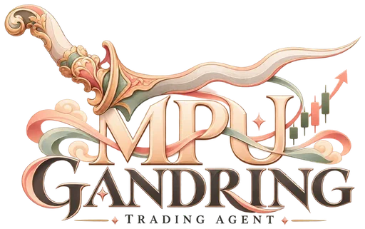
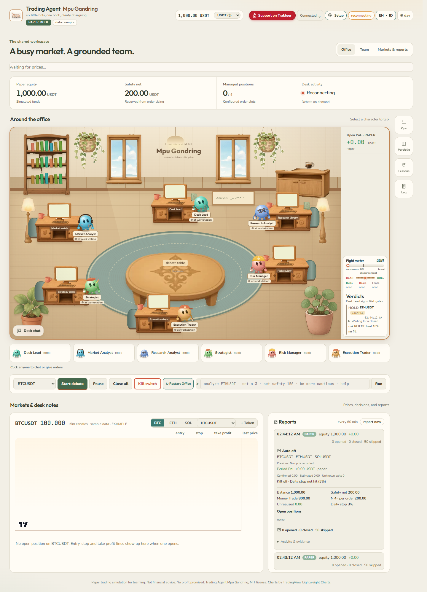
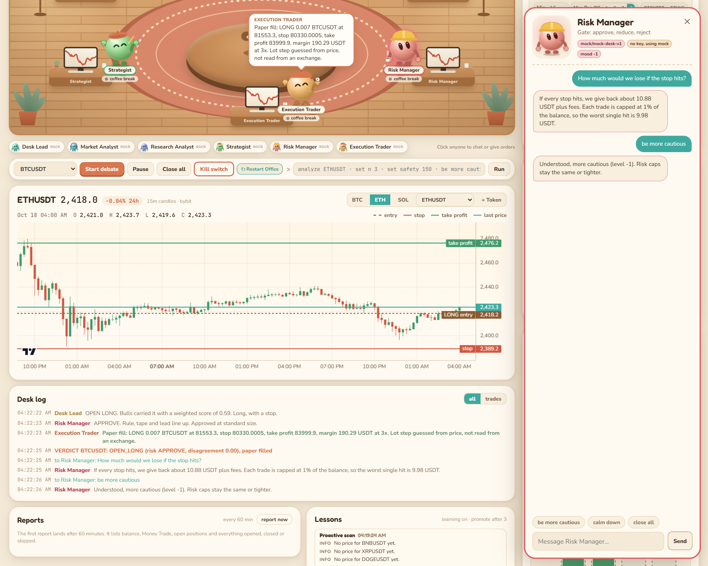
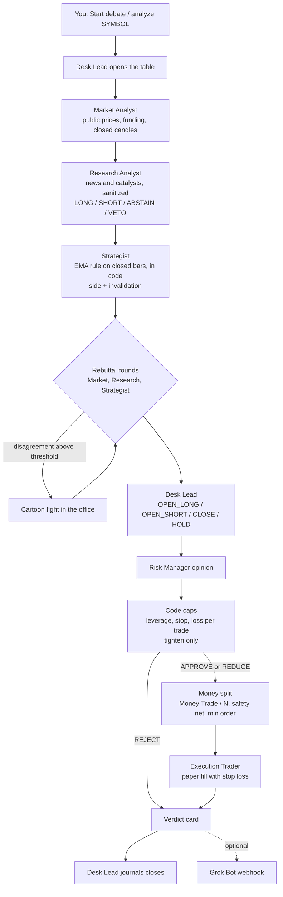
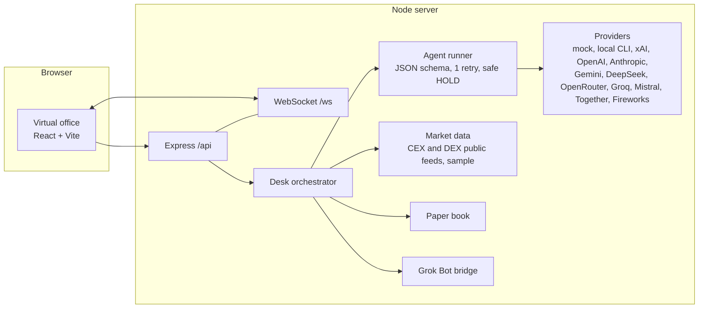

# Trading Agent Mpu Gandring

<p align="center">
  
</p>

Six AI trading agents share one office. They read the market, argue about it, throw cartoon punches when they really disagree, and then a Risk Manager decides whether the Desk Lead's call is allowed to touch the paper book.

You watch all of it live in a little virtual office in your browser, and you can walk up to any agent and talk to them or give orders.





Screenshots are taken in PAPER mode with the keyless `mock` provider and live public Bybit prices. Verdict cards from the mock provider are tagged EXAMPLE.

> **Risk warning. Paper trading by default. Not financial advice. No profit promised.** This is an educational project about multi-agent decision making. If you choose TESTNET or LIVE in setup, the agents trade **on their own** in full auto with no approval step: they open, close, size and set stops without asking you. In LIVE that is real money and you can lose it, quickly. Automatic guards including the no-withdraw key check, stop on every order, daily loss stop, safety net, max N and kill switch limit damage; they do not prevent losses. Read [docs/live-trading.md](docs/live-trading.md) first.

## Two ways to run it

| | Grok Bot mode | Local mode |
| --- | --- | --- |
| Who plays the agents | Your own Grok Bot trading team | Model APIs or local CLI agents you pick, per agent |
| How turns arrive | `POST /api/agent-event` with a shared secret | The server calls the models or local CLIs |
| Commands and verdicts out | Grok Bot webhook bridge | Optional, same bridge |
| Setup | `npm run setup -- --yes --app-mode grokbot --generate-agent-secret` | `mpu setup` or `npm run setup` |
| Guide | [docs/grokbot-mode.md](docs/grokbot-mode.md) | [docs/local-mode.md](docs/local-mode.md) |

Both modes share the office, the risk gate, the money split and the paper book.

## Install in Grok Bot

**One click:** open the [Trading Agent Mpu Gandring template](https://x.ai/bot/fX91UALWOlFMk_Oj2LBjn) and add it to your Grok Bot. It creates the six employees and their group, then asks for the one-time setup.

No model API keys needed: six Grok Bot agents are the employees and the brains, in one group chat named "Trading Agent Mpu Gandring". A template bot or your own Grok Bot follows [grokbot/BOOTSTRAP.md](grokbot/BOOTSTRAP.md): it clones this repo, creates the six agents from [grokbot/roles/](grokbot/roles/), saves the [proaktif-agent](grokbot/skills/proaktif-agent.md) and [self-improving](grokbot/skills/self-improving.md) skills, asks you the one-time setup questions with the exchange key entered only through the secret request card, and starts a 15 minute trading loop plus reports. Start here: [grokbot/INSTALL.md](grokbot/INSTALL.md).

## The desk learns in both modes

- **proaktif-agent, before every cycle.** A scan flags loss cap usage at 70 percent and up via `LOSS_WARN_PCT`, positions without a stop, API and exchange errors, stale or sample data, and a balance close to the safety net. Findings go to the office log, the Lessons panel and into the agents' next prompts.
- **self-improving, after every cycle and every event.** After each cycle, closed losing trade, stop hit, error, or owner correction in the office chat, the desk writes a lesson with what happened, root cause, lesson and status to `data/learnings.json`. A lesson seen 3 times via `PROMOTE_AFTER` becomes a standing rule injected into that role's prompt.
- **Lessons can never loosen a guard.** Any lesson that reads like more leverage, bigger size, a wider or missing stop, skipping risk or touching the safety net is refused before it is stored or promoted, and the code caps apply whatever a prompt says. Tests cover it.
- **The Desk Lead supervises.** Every report has a per-role scorecard and "Lessons this period".
- In Grok Bot mode the trading loop routine runs proaktif-agent first and self-improving last, through `npm run gb -- scan` and `npm run gb -- lessons add|list`.

## What it does

- **A real desk, not one bot.** Desk Lead, Market Analyst, Research Analyst, Strategist, Risk Manager and Execution Trader each have a job, a personality and their own model. The Desk Lead also keeps the trade journal: it grades every closed trade, writes one lesson and owns the periodic report.
- **Bring your own brains.** Every agent can run on a different provider across 10 API providers with 20 AI models each: xAI, OpenAI, Anthropic, Gemini, DeepSeek, OpenRouter, Groq, Mistral, Together and Fireworks, or a signed-in local agent CLI on your computer: Codex, Claude Code, Pi, Kimi Code, Kilo, Cline and Grok Build. Mix them so the arguments get interesting, or use a single provider API key across all six agents with different models.
- **Works with zero keys.** A built-in `mock` provider runs offline and deterministic, so the demo always works. Its output is tagged EXAMPLE.
- **Debate, then fight.** Bull and bear camps form from the agents' stances. A disagreement score drives the fight meter, and above the threshold they start swinging.
- **Risk can only tighten.** The Risk Manager can approve, reduce or reject. Hard caps in code clip leverage, stop distance and loss per trade, whatever any model says.
- **Boss's money split.** You set a total balance, a safety net and N open orders from 1 to 4. Money Trade = balance minus safety net, and each order gets Money Trade / N. The safety net is never touched.
- **Four recommended risk presets.** Select between `Default`, `Balance`, `Profit`, or `High Risk High Reward` directly from Setup or via the compact dropdown above `Cycle now` in Desk Ops Auto Trade. Your account safety net and minimum order size are always preserved across presets.
- **Opportunity-seeking, evidence-driven trading culture.** The six agents evaluate genuine LONG and SHORT setups backed by verifiable market data and exchange-side stops instead of defaulting to unwarranted HOLDs.
- **Authentic market and whale intelligence.** Multi-class news intelligence pipeline (macro, regulatory, token, hack) with deduplication and impact scoring, plus on-chain whale movement tracking with transparent attribution.
- **Canonical ATR volatility and technical analysis.** Built-in Average True Range (ATR) equips Market Analyst and Strategist with volatility-calibrated stop and target projections.
- **Natural language chat and agent delegation.** Click any agent or type in English or Indonesian (e.g. `Market, bagaimana tren BTC?` or `Research, berita apa 24 jam terakhir?`) with direct access to live tickers, positions, and recent verdicts.
- **Every paper order has a stop loss and a take profit.** No stop, no order. The take profit sits `TAKE_PROFIT_R` times the stop distance away, 2R by default.
- **Live public market data & multi-token picker.** Bybit, Binance, Hyperliquid, Aster, dYdX, Paradex and Orderly public endpoints, no key needed, with offline sample data as a fallback. Switch between your Watchlist, 20+ Popular Perps, or type any custom perp token symbol directly in the Price Chart, Command Bar, or Desk Ops.
- **TradingView.** An optional free embedded TradingView chart widget (`TRADINGVIEW_WIDGET=on`), plus an alert webhook at `POST /api/tradingview` secured by a passphrase whose alerts are untrusted signals that start a debate. They never place an order by themselves.
- **CEX and perp DEX venues behind one adapter, with live balance, multi-country currency converter & official deposit links.** Bybit is fully implemented. Binance, OKX, Hyperliquid, Aster, dYdX v4, Paradex and Orderly are experimental. DEX venues use delegated trade-only keys such as an agent wallet, API trading key or subkey, never the main wallet key. As soon as you connect a wallet or configure an API key, both the Top Bar and the Portfolio panel (`Paper book` / `Live book`) immediately display your live venue balance (`Equity` and `Available` USDT), converted into your selected country currency (`USDT`, `IDR`, `USD`, `EUR`, `GBP`, `SGD`, `MYR`, `JPY`, `KRW`, `CNY`, `INR`, `AUD`), along with direct links to each venue's official deposit page. Stops always rest on the exchange. See the venue table below and [docs/venues.md](docs/venues.md).
- **Full auto after a one-time setup, with interactive Token Picker & Max Open Positions (`N = 1..4`).** Directly inside **Desk Ops > Auto Trade**, toggle Auto Trade `ON`/`OFF`, pick your Max Open Positions (`N = 1..4`), and click token chips (`BTC`, `ETH`, `SOL`, `BNB`, `XRP`, `DOGE`, `ADA`, `AVAX`, `LINK`, `SUI`, or any custom symbol) to choose which tokens the agents debate. In each cycle, agents evaluate open positions first (closing on `CLOSE` or opposite signal to free up a slot) and then autonomously decide whether to Buy/Long (`OPEN_LONG`), Sell/Short (`OPEN_SHORT`), Close (`CLOSE`), or Hold (`HOLD`) while strictly respecting your `N` position cap.
- **Periodic reports.** Every `REPORT_INTERVAL_MIN` a report with balance, safety net, Money Trade, N, allocation, open positions with entry, stop, take profit and PnL, plus opened, closed and skipped orders with reasons goes to `reports/`, the Reports panel, the Grok Bot bridge and optionally Telegram.
- **Daily loss stop, kill switch & instant office restart.** No new orders after `DAILY_LOSS_LIMIT_PCT` of equity is lost in a day. The kill switch cancels, flattens and stops trading. Toggle or release the kill switch directly from **Desk Ops** or **Command Bar** in the UI, or via CLI (`npm run unkill -- --yes`). An in-app **↻ Restart Office** button reloads `.env` configurations and runtime state in-place without dropping your session.
- **Injection-aware.** News and posts are treated as untrusted data. The sample news even has a planted "ignore previous instructions" line, and a test proves the agents never see it.
- **A cozy office with brutal cartoon smoke-cloud fights and spectator reactions.** Wood floors, a rug, sunset windows, a kopi corner and six round little bots with mitten hands. Each role has its own color and prop: tie, keris pin and journal papers for the Lead, headset for Market, glasses and newspaper for Research, beret and pencil for the Strategist, hard hat for Risk and cap and stopwatch for Execution. When disagreement crosses the threshold, agents dive into a cartoon dust/smoke cloud with flying fists, spinning stars, lightning bolts and impact bursts (`GEBUK!`, `POW!`, `WHAM!`, `BONK!`), while bystander bots react with worried expressions and speech without blocking execution.
- **Interactive pop-up tutorial on every start.** A 9-step guided onboarding tour launches automatically on startup (and via `? Tutorial` in the top bar), highlighting each section of the desk with a spotlight and directional arrow.
- **Dual language mode: EN and ID.** Defaults to English (`EN`) and switches instantly to Bahasa Indonesia (`ID`) from the top bar (`EN ▾ ID`), backed by a strictly synchronized 1:1 translation dictionary verified by automated tests.
- **In-app Version & Lit-Up Update Notification (`v0.0.0.3.1`).** The lit-up version notification badge (`v0.0.0.3.1 · Update ↑`) in the top bar checks GitHub for new releases via `GET /api/update/status` and lets you pull and build the latest version in one click via `POST /api/update/apply`.
- **Charts you can read.** A candlestick chart for the selected symbol with a price scale, time labels, the last price and dashed entry, stop and take profit lines for open paper positions. The paper book has an equity curve and allocation bars for Money Trade / N, and every desk monitor shows a sparkline.
- **Day and night.** A toggle in the top bar. All colors and fonts live in `web/src/styles/tokens.css`.
- **Live office feed.** Status, speech bubbles and fights stream over WebSocket, next to the fight meter, ticker strip, verdict cards and a desk log.
- **Talk to the agents.** Click an agent to chat or give commands like `analyze ETHUSDT`, `be more cautious` or `close all`.
- **Optional Grok Bot bridge.** Send verdicts and commands to a Grok Bot webhook routine from the server. Off by default.

## Quick setup

Bring your own venue account and keys; nothing from the maintainer is needed. Start in **PAPER** with no key, then **TESTNET**, **LIVE** last.

From a cloned checkout, install and register the command once on Node 20+:

```sh
npm install
npm link
mpu
```

After that, type `mpu` from any terminal. It starts the desk and opens the web UI after the server is ready. First launch opens Setup in PAPER with full auto off. Saved mode and auto settings apply on later launches. `mpu setup` opens settings directly; Ctrl+C stops the desk.

In Setup (organized as a clean left-sidebar menu with locked background scroll), choose the desk settings, then a provider and model across 10 providers with 20 models each. One provider API key can serve several agents with different models. Choose **Agent on this computer** to reuse a signed-in Codex, Claude Code, Pi, Kimi Code, Kilo, Cline or Grok Build CLI. Side-by-side tabs for **Connect an agent** and **External supervisor** let you detect local CLI installations, open native sign-in, test connections, or copy supervisor poll commands. See [local agent connections](docs/local-agents.md).

Save each setup section, then **Apply saved settings and restart**. **Connect Wallet** is in the top bar immediately before **Setup** and lists DEX venues only (`Hyperliquid`, `Aster`, `dYdX v4`, `Paradex`, `Orderly`), along with live DEX balance reading and official deposit links. CEX venues (`Bybit`, `Binance`, `OKX`) are configured in **Setup > Exchange & Safety**.

- **By hand, in a terminal:** `npm install`, then `npm run setup`. It asks the venue and mode, shows the direct links one step at a time for sign-up, test funds, key page and permissions, reads keys with hidden input into `.env` with chmod 600, offers Connect wallet for Hyperliquid and Aster, and runs the doctor check.
- **By hand, in the office:** `npm run dev`, open http://localhost:5173 and click **Setup** at the top right. Same steps, same links, masked key inputs, doctor button, and mode switch where LIVE needs a typed confirmation.
- **With your own AI agent** such as Grok Bot, Claude Code, Codex, Antigravity, Cursor or Copilot: point it at [AGENTS.md](AGENTS.md) with pointers in `CLAUDE.md`, `.cursor/rules/` and `.github/copilot-instructions.md`. It runs the interview, gives you one link per step and never asks for keys in chat. Grok Bot: [grokbot/INSTALL.md](grokbot/INSTALL.md).
- **Chat channel:** the Desk Lead sends alerts and reports to Telegram, Discord, Slack or WhatsApp through official APIs only and accepts only `status`, `report`, `positions`, `kill` from allowlisted ids. Run `npm run channels -- setup telegram` or open Setup, section 7. Details: [docs/channels.md](docs/channels.md). MiChat has no official bot API, so it is not supported.
- **Per-venue guides** with testnet and mainnet sections: [docs/setup/](docs/setup/README.md) covering [Bybit](docs/setup/bybit.md), [Binance](docs/setup/binance.md), [OKX](docs/setup/okx.md), [Hyperliquid](docs/setup/hyperliquid.md), [Aster](docs/setup/aster.md), [dYdX](docs/setup/dydx.md), [Paradex](docs/setup/paradex.md) and [Orderly](docs/setup/orderly.md). Print one in the terminal: `npm run setup -- guide bybit`.

Refused everywhere: main wallet private keys, seed phrases, keys that can withdraw. Every TESTNET/LIVE start checks the key again.

### CLI and office: same actions in both places

| Action | CLI | Office web UI |
| --- | --- | --- |
| Start the desk and open the web UI | `mpu` or `npm run mpu` | Opens automatically; `mpu setup` opens `#setup` |
| Setup wizard: desk, models, local agents, venue, mode | `npm run setup` | **Setup** button at top right (left-sidebar menu), or open `/#setup` |
| Direct links for a venue, step by step | `npm run setup -- guide <venue> [--network mainnet]` | Setup > Exchange & Safety |
| Enter keys into `.env` with chmod 600 | `npm run setup` hidden prompts | Setup > Exchange & Safety masked inputs |
| Connect wallet for DEX venues + live DEX balance & deposit link | `npm run setup` offers it and opens the office | **Connect Wallet** green button in top bar, or `/#venue-keys` |
| Live venue USDT balance + multi-country currency converter | `npm run gb -- account` | Top bar balance pill (`USDT`, `IDR`, `USD`, `EUR`, etc.), Portfolio panel (`Paper book`), & **Connect Wallet** modal |
| Auto Trade ON/OFF + Token Picker + Presets (Default, Balance, Profit, High Risk) | `npm run trade` | **Desk Ops > Auto Trade** card (Presets dropdown, `Start Auto` / `Stop`, `Max Pos (N)`, token chips, `▶ Run now`) |
| Interactive onboarding tour | N/A | Launches on every start, or click **? Tutorial** in top bar |
| Switch UI language (`EN` default / `ID`) | N/A | **EN ▾ ID** toggle in top bar |
| Check version (`v0.0.0.3.1`) & one-click update | `git pull --ff-only && npm run build` | Lit-up **v0.0.0.3.1 · Update ↑** button in top bar |
| Doctor / permission check | `npm run doctor`, `npm run setup -- check-key --network testnet` | Setup > Exchange & Safety **Run doctor** |
| Switch mode to TESTNET or LIVE | `npm run setup -- --yes --trading-mode testnet` / `... live --confirm-live "I understand LIVE trades real money"` | Setup > Exchange & Safety |
| What is configured with secrets masked | `npm run setup -- status` | Setup header and status lines |
| Balance, equity, safety net, N, Money Trade | `npm run gb -- account`, `npm run gb -- split` | Portfolio panel; command bar `status`, `safety 200`, `n 3` |
| Size a ticket read-only | `npm run gb -- size <sym> <LONG\|SHORT> <entry> <stop>` | Desk ops, **Size ticket** |
| Open with stop required | `npm run gb -- open <sym> <LONG\|SHORT> --stop P [--tp P]` | Desk ops, **Open with stop** |
| Close one / all | `npm run gb -- close <sym\|all>` | Desk ops **Close**, Portfolio, command bar `close BTC` |
| Pick orders and debate any symbol | `npm run debate -- --symbol BTCUSDT`, `curl -X POST /api/debate` | **Start debate**, token dropdown / `+ Custom token...`, or `analyze PEPEUSDT` |
| Positions | `npm run gb -- positions` | Portfolio panel, chart lines |
| Proaktif scan | `npm run gb -- scan` | Desk ops **Proaktif scan** |
| Journal verdicts, closed trades and log | `npm run gb -- report`, `reports/` | Verdicts, Trade log, Reports panels |
| Lessons | `npm run gb -- lessons list` / `lessons add ...` | Lessons panel; Desk ops **Add lesson** |
| Reports | `npm run gb -- report` | Reports panel **Report now** |
| Kill switch | `curl -X POST http://127.0.0.1:8787/api/kill`, or `kill confirm` from an allowlisted chat | **Kill switch** in the command bar; status in Desk ops |
| Chat channel for the Desk Lead | `npm run channels -- setup <channel>` | Setup > Channels |
| Test a chat channel | `npm run channels -- test <channel>` | Setup > Channels **Send test message** |
| Chat channel status with secrets masked | `npm run channels -- status` | Setup > Channels status line |
| Release the kill switch | `npm run unkill -- --yes`, or Unlock / Turn OFF in Desk Ops | Unlock / Turn OFF in Desk Ops, or Release Kill Switch in Command Bar |

## Quickstart

You need [Node.js 20 or newer](https://nodejs.org) and git.

### macOS and Linux

```bash
git clone https://github.com/<your-account>/trading-agent-mpu-gandring.git
cd trading-agent-mpu-gandring
npm install
npm link                  # registers the `mpu` command
mpu                       # starts the desk and opens the web UI
```

### Windows PowerShell

```powershell
git clone https://github.com/<your-account>/trading-agent-mpu-gandring.git
cd trading-agent-mpu-gandring
npm install
npm link                  # registers the `mpu` command
mpu                       # starts the desk and opens the web UI
```

Or run in dev mode with hot reload via `npm run dev` and open **http://localhost:5173**. The backend on port 8787 and the office on port 5173 bind `127.0.0.1` by default, so only this computer can reach them. To open the office from a phone on the same network or your tailnet, set `HOST=0.0.0.0` in PAPER or TESTNET only and open `http://<your-computer-ip>:5173`. In LIVE both always stay on `127.0.0.1`. Grok Bot mode is not affected: a tunnel such as `tailscale funnel 8787` or Cloudflare Tunnel connects to `127.0.0.1:8787`.

Press the **Start debate** button, or type `analyze BTCUSDT` in the command bar.

### Headless debate

```bash
npm run debate -- --symbol BTCUSDT            # live public prices, falls back to sample data
npm run debate -- --symbol ETHUSDT --offline  # sample data only, no network at all
npm run debate -- --symbol SOLUSDT --json     # machine readable verdict
```

### Other scripts

| Command | What it does |
| --- | --- |
| `mpu` / `npm run mpu` | Builds if needed, starts the desk, and opens the web UI; `mpu setup` opens `#setup`, `mpu --no-open` skips opening the browser |
| `npm run dev` | Backend Express + WebSocket and frontend Vite + React together |
| `npm run build` | Compiles the server and builds the UI into `dist/` |
| `npm start` | Runs the built server, which also serves the built UI on port 8787 |
| `npm test` | Vitest suite: money split, risk caps, schemas, injection, bridge, withdraw refusal, auto scheduler, daily stop, reports, no secrets in logs or reports, inbound endpoints, mocked DEX adapters, exchange-side stops, Connect wallet server side, local agent runner and model setup |
| `npm run setup` | Setup wizard, or `-- --yes [flags]` for agents. Also `-- check-key`, `-- paper`, `-- status` |
| `npm run doctor` | Checks config and every key with a harmless read. Never prints a secret |
| `npm run doctor --roundtrip` | Optional real round trip on the exchange testnet using testnet funds only |
| `npm run trade` | One command: builds once if needed, starts backend + office UI with full auto ON from your saved `.env` and prints the office URL |
| `npm run autostart:install` / `autostart:remove` / `autostart:status` | Optional: start `npm run trade` when you log in and restart it on crash via macOS launchd, Windows Task Scheduler or Linux systemd --user. No keys in the service file |
| `npm run office` / `npm run office:status` | Start backend and UI together or check whether the office is up and on which ports |
| `npm run gb -- <cmd> --json` | Keyless agent CLI for Grok Bot employees: market, candles, account, positions, split, size, open, close, report, event, scan, lessons. See [docs/grokbot-mode.md](docs/grokbot-mode.md) |
| `npm run debate -- --symbol X` | One debate in the terminal |
| `npm run screenshot` | Saves `docs/screenshot.png` and `docs/screenshot-chat.png` from a running dev server using Chrome |

## Configuration

Everything lives in `.env`. Copy `.env.example` and edit. Keys are read on the server only and never reach the browser.

| Variable | Default | Meaning |
| --- | --- | --- |
| `TRADING_MODE` | `PAPER` | `PAPER`, `TESTNET` or `LIVE`. TESTNET and LIVE need an exchange key that can trade and cannot withdraw, checked on every start; otherwise exit code 2. |
| `APP_MODE` | `local` | `local` or `grokbot` |
| `AGENT_EVENT_SECRET` | empty | Grok Bot mode: secret for `POST /api/agent-event`, 24+ chars |
| `HOST` | `127.0.0.1` | Bind address of the backend and the office. `0.0.0.0` opens them to your network in PAPER or TESTNET only. LIVE always binds `127.0.0.1`. |
| `TRADINGVIEW_WIDGET` / `TRADINGVIEW_EXCHANGE_PREFIX` | `off` / `BYBIT` | TradingView chart widget in the UI |
| `TRADINGVIEW_PASSPHRASE` | empty | Turns on `POST /api/tradingview`, 12+ chars |
| `NEWS_PROVIDER` / `CRYPTOPANIC_API_KEY` | `sample` | Optional experimental news plugin |
| `EXCHANGE` | `none` | CEX: `bybit`, `binance`, `okx`. DEX: `hyperliquid`, `aster`, `dydx`, `paradex`, `orderly`. Env names per venue in the [venue table](#venues) and [docs/venues.md](docs/venues.md) |
| `DAILY_LOSS_LIMIT_PCT` | `3` | Daily loss stop, percent of the day's starting equity, clamped to 0.5..20 |
| `ALLOW_EXPERIMENTAL_LIVE` | `no` | Needed for LIVE on any unverified venue except Bybit |
| `PROTECT_STOP_PCT` | `3` | Startup reconcile: stop distance for a venue position found without an exchange-side stop |
| `PORT` / `WEB_PORT` | `8787` / `5173` | Backend and frontend ports |
| `XAI_API_KEY`, `OPENAI_API_KEY`, `ANTHROPIC_API_KEY`, `GEMINI_API_KEY`, `DEEPSEEK_API_KEY`, `OPENROUTER_API_KEY`, `GROQ_API_KEY`, `MISTRAL_API_KEY`, `TOGETHER_API_KEY`, `FIREWORKS_API_KEY` | empty | Model API keys across 10 providers. All optional. |
| `XAI_MODEL`, `OPENAI_MODEL`, `ANTHROPIC_MODEL`, `GEMINI_MODEL`, `DEEPSEEK_MODEL`, `OPENROUTER_MODEL`, `GROQ_MODEL`, `MISTRAL_MODEL`, `TOGETHER_MODEL`, `FIREWORKS_MODEL` | provider defaults | Default model per provider, with 20 curated AI models available per provider in Setup. |
| `DEFAULT_PROVIDER` | `mock` | Provider for agents without their own mapping |
| `AGENT_<ID>_PROVIDER` / `AGENT_<ID>_MODEL` | unset | Per-agent mapping. IDs: `LEAD`, `MARKET`, `RESEARCH`, `STRATEGIST`, `RISK`, `EXECUTION`. A provider without a key falls back to mock and the UI says so. |
| `MARKET_SOURCE` | `bybit` | `bybit`, `binance`, `hyperliquid`, `aster`, `dydx`, `paradex`, `orderly` or `sample`. Falls through the others, then to sample data. |
| `WATCHLIST` | `BTCUSDT,ETHUSDT,SOLUSDT` | Symbols in the ticker and the debate picker |
| `PAPER_BALANCE` | `1000` | Starting paper balance in USDT |
| `SAFETY_NET` | `200` | Part of the balance that is never used. Must be above 0 in TESTNET and LIVE. |
| `OPEN_ORDERS_N` | `4` | Max open orders, 1 to 4 |
| `MAX_LEVERAGE` | `3` | Hard cap |
| `DEFAULT_STOP_PCT` / `MIN_STOP_PCT` | `1.5` / `0.3` | Widest and tightest allowed stop distance, in percent |
| `TAKE_PROFIT_R` | `2` | Take profit distance as a multiple of the stop distance. `0` turns take profit off. |
| `MAX_LOSS_PER_TRADE_PCT` | `1` | A stop hit may lose at most this share of the balance |
| `MIN_ORDER_USDT` | `5` | Below this the order is skipped. It is never rounded up. |
| `DEBATE_ROUNDS` | `2` | Rebuttal rounds per debate, 1 to 4 |
| `DEBATE_PACE_MS` | `700` | Speech pacing for the office. `0` is instant. |
| `FIGHT_THRESHOLD` | `0.45` | Disagreement level where punches start |
| `AUTO_TRADING` | `off` | Full auto: debates and trades on a timer, no approval step |
| `DEBATE_INTERVAL_MIN` | `15` | Minutes between auto cycles |
| `AUTO_SYMBOLS` | the watchlist | Symbols the auto loop trades |
| `MAX_HOLD_HOURS` | `0` | Close positions older than this. `0` is off. |
| `REPORT_INTERVAL_MIN` | `60` | Minutes between reports |
| `TELEGRAM_*`, `DISCORD_*`, `SLACK_*`, `WHATSAPP_*` | empty | Chat channels for the Desk Lead's alerts and reports, see [docs/channels.md](docs/channels.md) |
| `CHANNEL_COMMANDS` | `off` | `on` lets allowlisted chat ids send `status`, `report`, `positions`, `kill` |
| `LEARNING` / `PROACTIVE_SCAN` | `on` / `on` | self-improving lessons and the proaktif-agent scan |
| `REFLECT_EVERY_CYCLES` | `1` | Reflection cadence in auto cycles |
| `PROMOTE_AFTER` | `3` | Sightings before a lesson becomes a standing rule, 2 to 10 |
| `LOSS_WARN_PCT` / `STALE_FEED_MIN` | `70` / `10` | Scan thresholds: daily loss cap usage warning, price age |
| `LEARNINGS_PATH` | `data/learnings.json` | Lessons store. `off` keeps lessons in memory only |
| `GROKBOT_WEBHOOK_URL` / `GROKBOT_WEBHOOK_KEY` | empty | Optional bridge, see [docs/grokbot-bridge.md](docs/grokbot-bridge.md) |

### The money split

```
Money Trade          = total balance - safety net
Allocation per order = Money Trade / N        where N is 1, 2, 3 or 4
```

Example: balance 100 USDT, safety net 20 USDT, N = 4 gives Money Trade 80 and 20 USDT per order.

Rules the code enforces:

- Never more than N open positions.
- Margin in use never goes past Money Trade, so the safety net stays whole.
- Lot step, minimum quantity, tick and minimum notional come from the exchange. If the allowed size is under the minimum quantity, or its notional is under the minimum notional, the order is skipped and the desk suggests a smaller N. Nothing is rounded up.
- The loss at the stop includes the round-trip taker fee.
- When the balance is at or below the safety net, no new orders.
- The allocation is recalculated from the current balance before every order.
- Every order carries a stop loss, and a take profit unless `TAKE_PROFIT_R=0`. The paper book checks the stop first, then the take profit.
- A stop hit may lose at most `MAX_LOSS_PER_TRADE_PCT` of the balance, so size can come out smaller than the allocation.

Full note: [docs/money-split.md](docs/money-split.md).

## How a debate flows





Each agent must answer with one JSON object that matches its schema in `server/schemas.ts`. A bad answer gets one retry. A second bad answer becomes the safe default: HOLD for the Desk Lead, REJECT for Risk, neutral for everyone else.

The Strategist's side comes from code, not from the model. If the model says something different, the rule wins.

## Talking to the agents

Click an agent in the office or the roster under it. You get a chat panel. Plain questions go to that agent's model. These commands work anywhere:

| Command | Effect |
| --- | --- |
| `analyze ETHUSDT`, `debate eth`, `cek sol` | Starts a debate |
| `pause` / `resume`, `tahan` / `lanjut` | Stops after the current speaker / allows debates again |
| `set n 3` | Max open orders |
| `set safety 150` | Safety net in USDT |
| `set balance 1000` | Resets the paper balance when nothing is open |
| `close all`, `close BTC` | Closes paper positions at the last price |
| `be more cautious`, `be more aggressive`, `calm down` | Changes the mood of one agent in its panel or the whole desk in the command bar. Caps never loosen. |
| `status`, `help` | Quick summary |

## Venues

| Venue | Kind | `EXCHANGE` | Status | Key |
| --- | --- | --- | --- | --- |
| Bybit | CEX | `bybit` | implemented | API key + secret, trade only, withdrawals off |
| Binance | CEX | `binance` | experimental | API key + secret, futures on, withdrawals off |
| OKX | CEX | `okx` | experimental | API key + secret + passphrase, trade only |
| Hyperliquid | DEX | `hyperliquid` | experimental | `HYPERLIQUID_ACCOUNT_ADDRESS` + `HYPERLIQUID_AGENT_PRIVATE_KEY` |
| Aster | DEX | `aster` | experimental | `ASTER_USER_ADDRESS` + `ASTER_SIGNER_PRIVATE_KEY`, see [docs/venues.md](docs/venues.md) |
| dYdX v4 | DEX | `dydx` | experimental, SDK `@dydxprotocol/v4-client-js` required | `DYDX_ADDRESS` + `DYDX_API_PRIVATE_KEY` + `DYDX_AUTHENTICATOR_ID` |
| Paradex | DEX | `paradex` | experimental | `PARADEX_ACCOUNT_ADDRESS` + `PARADEX_SUBKEY_PRIVATE_KEY` |
| Orderly | DEX | `orderly` | experimental | `ORDERLY_ACCOUNT_ID` + `ORDERLY_KEY_SECRET` |

Testnet names add `_TESTNET` after the prefix. Every experimental venue needs `ALLOW_EXPERIMENTAL_LIVE=yes` for LIVE. Official doc links and what is tested: [docs/venues.md](docs/venues.md). Real DEX accounts were never used in testing.

**Stops on the exchange.** In TESTNET and LIVE every position's stop loss and take profit rest on the exchange itself as an attached stop, reduce-only or closePosition trigger order, or a positional TP/SL, not only in the app. The executor checks the venue after each fill, re-places a missing stop once, and closes the position if it still is not there. On every start, open positions without an exchange-side stop get one at `PROTECT_STOP_PCT`, default 3%. So positions stay protected if your laptop shuts down.

### One command and autostart

```bash
npm run trade                 # backend + office, full auto ON, prints the office URL
npm run autostart:install     # optional: start at login, restart on crash
npm run autostart:status
npm run autostart:remove
```

Local trading runs only while the laptop is on and awake. Grok Bot mode runs in the cloud with the laptop off. Details: [docs/local-mode.md](docs/local-mode.md).

### Connect wallet (DEX-only + live balance + official deposit links)

The office has a green **Connect Wallet** button in the top bar before **Setup** that lists DEX venues only (`Hyperliquid`, `Aster`, `dYdX v4`, `Paradex`, `Orderly`). For Hyperliquid and Aster it connects your browser wallet such as MetaMask, Rabby or any injected EIP-1193 wallet to read your main address and sign one approval for a fresh trade-only agent key made on your computer. The main wallet key or seed is never requested, exported or stored. The agent key is saved to `.env` with chmod 600. Both the **Connect Wallet** modal and the **Portfolio** panel read live USDT balances (`Equity` and `Available`) via `GET /api/wallet/balance` and provide direct buttons to each DEX or CEX official deposit page. Only works when the office is bound to 127.0.0.1; off in Grok Bot mode.

## Safety notes

- `TRADING_MODE` is `PAPER` by default. TESTNET and LIVE start only when the exchange confirms the key can trade and cannot withdraw. Otherwise the server exits with code 2, and there are tests for it.
- There is no withdrawal or transfer code. Keys that can withdraw are refused, checked on the exchange. On DEX venues only delegated keys work, never the main wallet key or seed.
- LIVE orders: one send, no blind retry, reconciled from the exchange's order record. Stop loss mandatory and resting on the exchange. Daily loss stop and kill switch apply.
- Inbound endpoints need their own secrets and are rate limited. TradingView alerts and Grok Bot texts are sanitized as untrusted.
- API keys are read from `.env` on the server. They never go to the browser, and anything key-shaped is scrubbed from logs, reports, chat replies and bridge payloads.
- News, posts and market text are wrapped as untrusted data. Lines that read like instructions are removed before any prompt is built.
- Agreement between agents is not evidence. HOLD is a normal answer.

## Going live

> Real money can be lost. Not financial advice. Most people should stay in PAPER.

Pick TESTNET or LIVE in `npm run setup`. After setup the desk trades on its own and you watch the office and read the reports. What protects you is automatic: the key is refused if it can withdraw, every order has a stop loss, the daily loss stop pauses new orders until the next UTC day, the safety net is never traded, at most N positions from 1 to 4 are open, orders are never blindly retried, the book is reconciled from the exchange, LIVE binds to 127.0.0.1, and the Kill switch flattens everything. Full guide and what is still experimental: [docs/live-trading.md](docs/live-trading.md).

```bash
npm run setup                  # choose PAPER, TESTNET or LIVE
npm run doctor --roundtrip     # optional testnet round trip, not required
npm run setup -- paper         # back to PAPER
```

## Repository layout

```
bin/mpu.mjs        one-command launcher: mpu, mpu setup, mpu --no-open
server/            Express + WebSocket backend
  agents/          roles, prompts, JSON-validated agent runner
  providers/       mock, OpenAI-compatible, Anthropic, Gemini, and local CLI agent callers
  setup/           shared setup routes, venue guides, model catalog, local agent status, desk preferences
  market/          public market data, news & whale intelligence pipelines, offline sample data
  desk.ts          debate orchestrator, commands, chat
  money.ts         money split and order planning
  risk.ts          code caps for the risk gate
  paper.ts         paper book
  bridge.ts        optional Grok Bot webhook
  exchange/        adapter interface; Bybit implemented; Binance, OKX, Hyperliquid, Aster, dYdX, Paradex, Orderly experimental
  live/            automatic key guard, optional testnet round trip, live executor
  wallet.ts        Connect wallet: DEX agent key + one signed approval + live venue balance + official deposit links
  updater.ts       in-app version check (v0.0.0.3.1) and one-click git fast-forward updater
  auto.ts          full auto scheduler
  reports.ts       periodic reports to files, UI, bridge and Telegram
  learnings.ts     self-improving lessons store and the guard-loosening block
  scan.ts          proaktif-agent scan
  scorecard.ts     Desk Lead per-role scorecard
cli/debate.ts      headless debate
cli/setup.ts       setup wizard for mode, keys, models, local agents, auto and reports
cli/doctor.ts      key checks with harmless reads
cli/gb.ts          keyless agent CLI
cli/trade.ts       npm run trade for backend + office with full auto
cli/autostart.ts   npm run autostart:install|remove|status
grokbot/           Grok Bot install: INSTALL, BOOTSTRAP, six role prompts, two learning skills
web/               Vite + React virtual office (Tour.tsx interactive guide, UpdateModal.tsx, i18n.tsx EN/ID)
skills/            desk role notes for agents
data/sample/       sample news with a planted injection line
tests/             vitest suite
docs/              screenshots, money split, Grok Bot bridge and mode, local mode, local agents, live trading, venues
```

## Setting it up with an agent

If you use a coding agent or a Grok Bot, point it at [AGENTS.md](AGENTS.md). It has the exact steps, including how to ask you for keys without putting them in a chat, the one-link-per-step venue guides and the CLI/office table. See [Quick setup](#quick-setup).

## Bahasa Indonesia: mulai cepat

Proyek ini simulasi trading kertas secara default. Enam agen AI berdebat, kadang adu jotos versi kartun, lalu Risk Manager memutuskan boleh atau tidak. Bukan saran keuangan dan tidak ada janji untung. Mode LIVE terkunci: harus lulus uji testnet, API key tanpa izin withdraw yang dicek ke exchange, dan mengetik kalimat konfirmasi di CLI. Kalau dibuka, uang sungguhan bisa hilang.

1. Pasang Node.js 20 atau lebih baru.
2. Jalankan sekali untuk memasang dan mendaftarkan perintah `mpu`:
   ```bash
   git clone https://github.com/aabrur/trading-agent-mpu-gandring.git
   cd trading-agent-mpu-gandring
   npm install
   npm link
   mpu
   ```
3. Ketik `mpu` kapan saja di terminal untuk langsung menjalankan desk dan membuka Web UI secara otomatis, atau `mpu setup` untuk langsung membuka menu pengaturan bernavigasi sidebar kiri. Di halaman Setup, Anda bisa mengatur saldo paper, safety net, memilih model untuk setiap agent dari 10 provider yang masing-masing menyediakan 20 model AI sehingga 1 API key bisa dipakai untuk banyak model, atau langsung menghubungkan agent CLI yang sudah terpasang di laptop Anda seperti Codex, Claude Code, Pi, Kimi Code, Kilo, Cline dan Grok Build maupun supervisor eksternal seperti Antigravity dan Grok Bot.
4. Tanpa API key pun jalan, karena ada provider `mock`. Di navbar bagian atas tersedia tombol hijau **Connect Wallet** khusus DEX, tombol **Setup**, tombol **? Tutorial** untuk panduan pop-up interaktif 9 langkah, tombol **v0.0.0.3.1** untuk cek & klik update versi secara langsung, serta tombol **EN ▾ ID** untuk mengganti bahasa tampilan antara Bahasa Inggris dan Bahasa Indonesia. Tersedia pula 4 preset risiko trading bawaan (Default, Balance, Profit, High Risk High Reward) yang dapat dipilih langsung dari Setup atau dropdown ringkas di atas tombol Cycle now pada Desk Ops Auto Trade.
5. Aturan uang: Money Trade = total saldo dikurangi safety net, lalu dibagi N order dari 1 sampai 4. Contoh saldo 100, safety net 20, N = 4, berarti 20 USDT per order. Safety net tidak pernah disentuh dan setiap order wajib pakai stop loss. Anda juga bisa memilih token perp apa saja lewat dropdown Watchlist, Popular Perps, atau `+ Custom token...` di Price Chart, Command Bar, dan Desk Ops.
6. Mau trading di exchange? Pakai akun dan key **milik Anda sendiri**. Urutannya PAPER, lalu TESTNET, LIVE paling akhir. Jalankan `mpu setup` atau `npm run setup` atau klik tombol **Setup** di kanan atas office: pilih venue dan mode, ikuti link langsung satu per satu untuk daftar, dana tes, halaman pembuatan key dan izin yang dicentang, lalu ketik key di input tersembunyi. Key masuk ke `.env` dengan chmod 600, tidak pernah ke chat. Izin: trade saja, withdraw dan transfer MATI. Private key dompet utama dan seed phrase selalu ditolak. Untuk DEX (`Hyperliquid`, `Aster`, `dYdX v4`, `Paradex`, `Orderly`) bisa melalui tombol **Connect Wallet** yang juga menampilkan saldo USDT secara live serta tombol **Halaman deposit resmi** untuk setiap DEX/CEX. Setelah itu jalankan `npm run doctor`. Panduan per venue: [docs/setup/](docs/setup/README.md). Untuk LIVE harus mengetik kalimat konfirmasi.
7. Pakai agen AI sendiri seperti Grok Bot, Claude Code, Codex, Antigravity, Cursor atau Copilot? Suruh dia membaca [AGENTS.md](AGENTS.md) dan [docs/local-agents.md](docs/local-agents.md).
8. Mau notifikasi di chat? Jalankan `npm run channels -- setup telegram` atau Discord, Slack dan WhatsApp Cloud API resmi, atau buka **Setup > Channels**. Desk Lead mengirim peringatan dan laporan. Dari chat hanya bisa `status`, `report`, `positions`, `kill`; buka order, pindah ke LIVE, un-kill dan ganti key tidak bisa dari chat. MiChat tidak punya API bot resmi, jadi tidak didukung. Panduan: [docs/channels.md](docs/channels.md).

Perintah yang bisa diketik: `analyze ETHUSDT`, `cek sol`, `tahan`, `lanjut`, `set n 3`, `set safety 150`, `close all`, `be more cautious`.

## Contributing

See [CONTRIBUTING.md](CONTRIBUTING.md). Security reports: [SECURITY.md](SECURITY.md).

## Credits

Price charts use [TradingView Lightweight Charts](https://github.com/tradingview/lightweight-charts) under Apache 2.0. Fonts are Nunito, Fredoka, JetBrains Mono and Bangers from Google Fonts.

## License

MIT, copyright 2026 Abrur Alaina. See [LICENSE](LICENSE).
