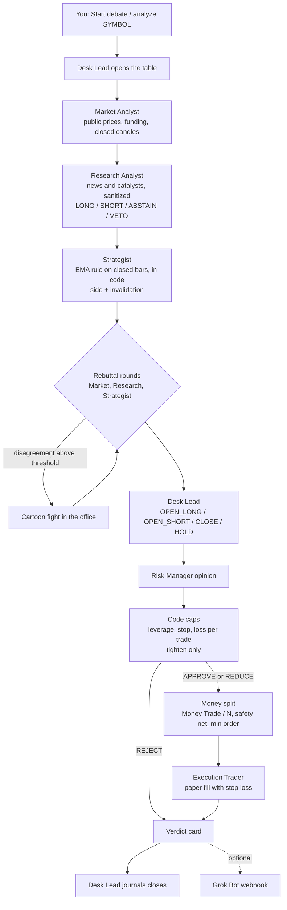
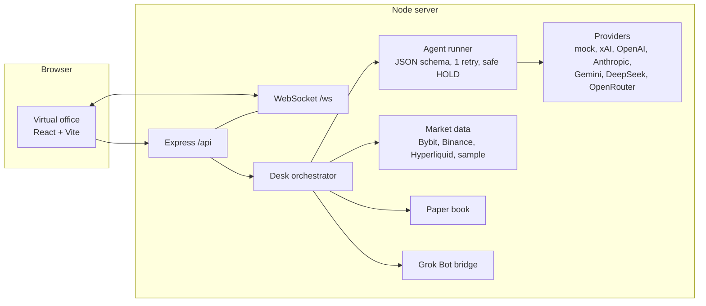

# Trading Agent Mpu Gandring

Six AI trading agents share one office. They read the market, argue about it, throw cartoon punches when they really disagree, and then a Risk Manager decides whether the Desk Lead's call is allowed to touch the paper book.

You watch all of it live in a little virtual office in your browser, and you can walk up to any agent and talk to them or give orders.


Screenshots use the offline sample data (`MARKET_SOURCE=sample`), so prices are tagged EXAMPLE.

> **Risk warning. Paper trading by default. Not financial advice. No profit promised.** This is an educational project about multi-agent decision making. If you choose TESTNET or LIVE in setup, the agents trade **on their own** (full auto, no approval step): they open, close, size and set stops without asking you. In LIVE that is real money and you can lose it, quickly. Automatic guards (no-withdraw key check, stop on every order, daily loss stop, safety net, max N, kill switch) limit damage; they do not prevent losses. Read [docs/live-trading.md](docs/live-trading.md) first.

## Two ways to run it

| | Grok Bot mode | Local mode |
| --- | --- | --- |
| Who plays the agents | Your own Grok Bot trading team | Model APIs you pick, per agent |
| How turns arrive | `POST /api/agent-event` with a shared secret | The server calls the models |
| Commands and verdicts out | Grok Bot webhook bridge | Optional, same bridge |
| Setup | `npm run setup -- --yes --app-mode grokbot --generate-agent-secret` | `npm run setup` |
| Guide | [docs/grokbot-mode.md](docs/grokbot-mode.md) | [docs/local-mode.md](docs/local-mode.md) |

Both modes share the office, the risk gate, the money split and the paper book.

## Install in Grok Bot

No model API keys needed: six Grok Bot agents are the employees and the brains, in one group chat named "Trading Agent Mpu Gandring". A template bot (or your own Grok Bot) follows [grokbot/BOOTSTRAP.md](grokbot/BOOTSTRAP.md): it clones this repo, creates the six agents from [grokbot/roles/](grokbot/roles/), saves the [proaktif-agent](grokbot/skills/proaktif-agent.md) and [self-improving](grokbot/skills/self-improving.md) skills, asks you the one-time setup questions (exchange key only through the secret request card), and starts a 15 minute trading loop plus reports. Start here: [grokbot/INSTALL.md](grokbot/INSTALL.md).

## The desk learns (on by default, both modes)

- **proaktif-agent, before every cycle.** A scan flags loss cap usage at 70 percent and up (`LOSS_WARN_PCT`), positions without a stop, API and exchange errors, stale or sample data, and a balance close to the safety net. Findings go to the office log, the Lessons panel and into the agents' next prompts.
- **self-improving, after every cycle and every event.** After each cycle, closed losing trade, stop hit, error, or owner correction in the office chat, the desk writes a lesson (what happened, root cause, lesson, status new, confirmed or promoted) to `data/learnings.json`. A lesson seen 3 times (`PROMOTE_AFTER`) becomes a standing rule injected into that role's prompt.
- **Lessons can never loosen a guard.** Any lesson that reads like more leverage, bigger size, a wider or missing stop, skipping risk or touching the safety net is refused before it is stored or promoted, and the code caps apply whatever a prompt says. Tests cover it.
- **The Desk Lead supervises.** Every report has a per-role scorecard and "Lessons this period".
- In Grok Bot mode the trading loop routine runs proaktif-agent first and self-improving last, through `npm run gb -- scan` and `npm run gb -- lessons add|list`.

## What it does

- **A real desk, not one bot.** Desk Lead, Market Analyst, Research Analyst, Strategist, Risk Manager and Execution Trader each have a job, a personality and their own model. The Desk Lead also keeps the trade journal: it grades every closed trade, writes one lesson and owns the periodic report.
- **Bring your own brains.** Every agent can run on a different provider: xAI, OpenAI, Anthropic, Gemini, DeepSeek or OpenRouter. Mix them so the arguments get interesting.
- **Works with zero keys.** A built-in `mock` provider runs offline and deterministic, so the demo always works. Its output is tagged EXAMPLE.
- **Debate, then fight.** Bull and bear camps form from the agents' stances. A disagreement score drives the fight meter, and above the threshold they start swinging.
- **Risk can only tighten.** The Risk Manager can approve, reduce or reject. Hard caps in code clip leverage, stop distance and loss per trade, whatever any model says.
- **Boss's money split.** You set a total balance, a safety net and N open orders (1 to 4). Money Trade = balance minus safety net, and each order gets Money Trade / N. The safety net is never touched.
- **Every paper order has a stop loss and a take profit.** No stop, no order. The take profit sits `TAKE_PROFIT_R` times the stop distance away (2R by default).
- **Live public market data.** Bybit, Binance and Hyperliquid public endpoints, no key needed, with offline sample data as a fallback.
- **TradingView.** An optional TradingView chart widget, and an alert webhook (`POST /api/tradingview`, passphrase) whose alerts are untrusted signals that start a debate. They never place an order by themselves.
- **Exchanges behind one adapter.** Bybit is fully implemented. Binance, OKX and Hyperliquid (API agent wallet only) are experimental. Exchange keys are used only for `npm run doctor`, TESTNET and LIVE.
- **Full auto after a one-time setup.** With `AUTO_TRADING=on` a scheduler runs a debate per symbol every `DEBATE_INTERVAL_MIN` and the verdicts execute by themselves: open, close on CLOSE or an opposite signal, stop or take profit, optional max holding time. No approval step, in both Grok Bot and local mode.
- **Periodic reports.** Every `REPORT_INTERVAL_MIN` a report (balance, safety net, Money Trade, N, allocation, open positions with entry, stop, take profit and PnL, opened, closed and skipped with reasons) goes to `reports/`, the Reports panel, the Grok Bot bridge and optionally Telegram (experimental).
- **Daily loss stop and kill switch.** No new orders after `DAILY_LOSS_LIMIT_PCT` of equity is lost in a day. The kill switch cancels, flattens and pauses until restart.
- **Injection-aware.** News and posts are treated as untrusted data. The sample news even has a planted "ignore previous instructions" line, and a test proves the agents never see it.
- **A cozy office.** Wood floors, a rug, sunset windows, a kopi corner and six round little bots with mitten hands. Each role has its own color and prop: tie, keris pin and journal papers for the Lead, headset for Market, glasses and newspaper for Research, beret and pencil for the Strategist, hard hat for Risk and cap and stopwatch for Execution. They walk to the table, type, point, punch, cheer when a trade fills and sweat when Risk says no.
- **Charts you can read.** A candlestick chart for the selected symbol with a price scale, time labels, the last price and dashed entry, stop and take profit lines for open paper positions. The paper book has an equity curve and allocation bars for Money Trade / N, and every desk monitor shows a sparkline.
- **Day and night.** A toggle in the top bar. All colors and fonts live in `web/src/styles/tokens.css`.
- **Live office feed.** Status, speech bubbles and fights stream over WebSocket, next to the fight meter, ticker strip, verdict cards and a desk log.
- **Talk to the agents.** Click an agent to chat or give commands like `analyze ETHUSDT`, `be more cautious` or `close all`.
- **Optional Grok Bot bridge.** Send verdicts and commands to a Grok Bot webhook routine from the server. Off by default.

## Quickstart

You need [Node.js 20 or newer](https://nodejs.org) and git.

### macOS and Linux

```bash
git clone https://github.com/<your-account>/trading-agent-mpu-gandring.git
cd trading-agent-mpu-gandring
npm install
npm run setup             # optional wizard: writes .env (keys stay on your computer)
npm run doctor            # optional: checks keys with harmless reads
npm test
npm run dev
```

### Windows (PowerShell)

```powershell
git clone https://github.com/<your-account>/trading-agent-mpu-gandring.git
cd trading-agent-mpu-gandring
npm install
npm run setup
npm test
npm run dev
```

Then open **http://localhost:5173**. The backend runs on port 8787 and binds `0.0.0.0`, so a phone on the same network (or your tailnet) can open `http://<your-computer-ip>:5173` too.

Press the **Start debate** button, or type `analyze BTCUSDT` in the command bar.

### Headless debate

```bash
npm run debate -- --symbol BTCUSDT            # live public prices, falls back to sample data
npm run debate -- --symbol ETHUSDT --offline  # sample data only, no network at all
npm run debate -- --symbol SOLUSDT --json     # machine readable verdict
```

### Other scripts

| Command | What it does |
| --- | --- |
| `npm run dev` | Backend (Express + WebSocket) and frontend (Vite + React) together |
| `npm run build` | Compiles the server and builds the UI into `dist/` |
| `npm start` | Runs the built server, which also serves the built UI on port 8787 |
| `npm test` | Vitest suite: money split, risk caps, schemas, injection, bridge, withdraw refusal, auto scheduler, daily stop, reports, no secrets in logs or reports, inbound endpoints |
| `npm run setup` | Setup wizard, or `-- --yes [flags]` for agents. Also `-- check-key`, `-- paper`, `-- status` |
| `npm run doctor` | Checks config and every key with a harmless read. Never prints a secret |
| `npm run doctor --roundtrip` | Optional real round trip on the exchange testnet (testnet funds only) |
| `npm run office` / `npm run office:status` | Start backend and UI together (same as dev, quiet output for background use) / check whether the office is up and on which ports |
| `npm run gb -- <cmd> --json` | Keyless agent CLI for Grok Bot employees: market, candles, account, positions, split, size, open, close, report, event, scan, lessons. See [docs/grokbot-mode.md](docs/grokbot-mode.md) |
| `npm run debate -- --symbol X` | One debate in the terminal |
| `npm run screenshot` | Saves `docs/screenshot.png` (overview mid-debate) and `docs/screenshot-chat.png` (agent chat and chart) from a running dev server (needs Chrome) |

## Configuration

Everything lives in `.env`. Copy `.env.example` and edit. Keys are read on the server only and never reach the browser.

| Variable | Default | Meaning |
| --- | --- | --- |
| `TRADING_MODE` | `PAPER` | `PAPER`, `TESTNET` or `LIVE`. TESTNET and LIVE need an exchange key that can trade and cannot withdraw, checked on every start; otherwise exit code 2. |
| `APP_MODE` | `local` | `local` or `grokbot` |
| `AGENT_EVENT_SECRET` | empty | Grok Bot mode: secret for `POST /api/agent-event` (24+ chars) |
| `HOST` | `0.0.0.0` (PAPER), `127.0.0.1` (TESTNET) | Bind address. LIVE always binds `127.0.0.1`. |
| `TRADINGVIEW_WIDGET` / `TRADINGVIEW_EXCHANGE_PREFIX` | `off` / `BYBIT` | TradingView chart widget in the UI |
| `TRADINGVIEW_PASSPHRASE` | empty | Turns on `POST /api/tradingview` (12+ chars) |
| `NEWS_PROVIDER` / `CRYPTOPANIC_API_KEY` | `sample` | Optional news plugin (experimental) |
| `EXCHANGE` | `none` | `bybit`, `binance`, `okx` or `hyperliquid`, plus `<VENUE>_[TESTNET_]API_KEY` / `_API_SECRET`. See [docs/local-mode.md](docs/local-mode.md) |
| `DAILY_LOSS_LIMIT_PCT` | `3` | Daily loss stop, percent of the day's starting equity, clamped to 0.5..20 |
| `ALLOW_EXPERIMENTAL_LIVE` | `no` | Needed for LIVE on Binance, OKX or Hyperliquid (unverified) |
| `PORT` / `WEB_PORT` | `8787` / `5173` | Backend and frontend ports |
| `XAI_API_KEY`, `OPENAI_API_KEY`, `ANTHROPIC_API_KEY`, `GEMINI_API_KEY`, `DEEPSEEK_API_KEY`, `OPENROUTER_API_KEY` | empty | Model keys. All optional. |
| `XAI_MODEL`, `OPENAI_MODEL`, ... | placeholders | Default model per provider. Model names change, so check your provider's list and edit. |
| `DEFAULT_PROVIDER` | `mock` | Provider for agents without their own mapping |
| `AGENT_<ID>_PROVIDER` / `AGENT_<ID>_MODEL` | unset | Per-agent mapping. IDs: `LEAD`, `MARKET`, `RESEARCH`, `STRATEGIST`, `RISK`, `EXECUTION`. A provider without a key falls back to mock and the UI says so. |
| `MARKET_SOURCE` | `bybit` | `bybit`, `binance`, `hyperliquid` or `sample`. Falls through the others, then to sample data. |
| `WATCHLIST` | `BTCUSDT,ETHUSDT,SOLUSDT` | Symbols in the ticker and the debate picker |
| `PAPER_BALANCE` | `1000` | Starting paper balance in USDT |
| `SAFETY_NET` | `200` | Part of the balance that is never used. Must be above 0 in TESTNET and LIVE. |
| `OPEN_ORDERS_N` | `4` | Max open orders, 1 to 4 |
| `MAX_LEVERAGE` | `3` | Hard cap |
| `DEFAULT_STOP_PCT` / `MIN_STOP_PCT` | `1.5` / `0.3` | Widest and tightest allowed stop distance, in percent |
| `TAKE_PROFIT_R` | `2` | Take profit distance as a multiple of the stop distance. `0` turns take profit off. |
| `MAX_LOSS_PER_TRADE_PCT` | `1` | A stop hit may lose at most this share of the balance |
| `MIN_ORDER_USDT` | `5` | Below this the order is skipped. It is never rounded up. |
| `DEBATE_ROUNDS` | `2` | Rebuttal rounds per debate (1 to 4) |
| `DEBATE_PACE_MS` | `700` | Speech pacing for the office. `0` is instant. |
| `FIGHT_THRESHOLD` | `0.45` | Disagreement level where punches start |
| `AUTO_TRADING` | `off` (setup writes `on`) | Full auto: debates and trades on a timer, no approval step |
| `DEBATE_INTERVAL_MIN` | `15` | Minutes between auto cycles |
| `AUTO_SYMBOLS` | the watchlist | Symbols the auto loop trades |
| `MAX_HOLD_HOURS` | `0` | Close positions older than this. `0` is off. |
| `REPORT_INTERVAL_MIN` | `60` | Minutes between reports |
| `TELEGRAM_BOT_TOKEN` / `TELEGRAM_CHAT_ID` | empty | Optional report channel (experimental, untested) |
| `LEARNING` / `PROACTIVE_SCAN` | `on` / `on` | self-improving lessons and the proaktif-agent scan |
| `REFLECT_EVERY_CYCLES` | `1` | Reflection cadence in auto cycles (closed trades, stops, errors and corrections always reflect at once) |
| `PROMOTE_AFTER` | `3` | Sightings before a lesson becomes a standing rule (2 to 10) |
| `LOSS_WARN_PCT` / `STALE_FEED_MIN` | `70` / `10` | Scan thresholds: daily loss cap usage warning, price age |
| `LEARNINGS_PATH` | `data/learnings.json` | Lessons store (gitignored). `off` keeps lessons in memory only |
| `GROKBOT_WEBHOOK_URL` / `GROKBOT_WEBHOOK_KEY` | empty | Optional bridge, see [docs/grokbot-bridge.md](docs/grokbot-bridge.md) |

### The money split

```
Money Trade          = total balance - safety net
Allocation per order = Money Trade / N        (N = 1, 2, 3 or 4)
```

Example: balance 100 USDT, safety net 20 USDT, N = 4 gives Money Trade 80 and 20 USDT per order.

Rules the code enforces:

- Never more than N open positions.
- Margin in use never goes past Money Trade, so the safety net stays whole.
- If an allocation is under the minimum order or under one lot step, the order is skipped and the desk suggests a smaller N. Nothing is rounded up.
- When the balance is at or below the safety net, no new orders.
- The allocation is recalculated from the current balance before every order.
- Every order carries a stop loss, and a take profit unless `TAKE_PROFIT_R=0`. The paper book checks the stop first, then the take profit.
- A stop hit may lose at most `MAX_LOSS_PER_TRADE_PCT` of the balance, so size can come out smaller than the allocation.

Full note: [docs/money-split.md](docs/money-split.md).

## How a debate flows





Each agent must answer with one JSON object that matches its schema (`server/schemas.ts`). A bad answer gets one retry. A second bad answer becomes the safe default: HOLD for the Desk Lead, REJECT for Risk, neutral for everyone else.

The Strategist's side comes from code, not from the model. If the model says something different, the rule wins.

## Talking to the agents

Click an agent in the office or the roster under it. You get a chat panel. Plain questions go to that agent's model. These commands work anywhere:

| Command | Effect |
| --- | --- |
| `analyze ETHUSDT` (or `debate eth`, `cek sol`) | Starts a debate |
| `pause` / `resume` (or `tahan` / `lanjut`) | Stops after the current speaker / allows debates again |
| `set n 3` | Max open orders |
| `set safety 150` | Safety net in USDT |
| `set balance 1000` | Resets the paper balance when nothing is open |
| `close all`, `close BTC` | Closes paper positions at the last price |
| `be more cautious`, `be more aggressive`, `calm down` | Changes the mood of one agent (in its panel) or the whole desk (in the command bar). Caps never loosen. |
| `status`, `help` | Quick summary |

## Safety notes

- `TRADING_MODE` is `PAPER` by default. TESTNET and LIVE start only when the exchange confirms the key can trade and cannot withdraw. Otherwise the server exits with code 2, and there are tests for it.
- There is no withdrawal or transfer code. Keys that can withdraw are refused, checked on the exchange. On Hyperliquid only an approved API agent wallet works, never the main key.
- LIVE orders: one send, no blind retry, reconciled from the exchange's order record. Stop loss mandatory. Daily loss stop and kill switch apply.
- Inbound endpoints need their own secrets and are rate limited. TradingView alerts and Grok Bot texts are sanitized as untrusted.
- API keys are read from `.env` on the server. They never go to the browser, and anything key-shaped is scrubbed from logs, reports, chat replies and bridge payloads.
- News, posts and market text are wrapped as untrusted data. Lines that read like instructions are removed before any prompt is built.
- Agreement between agents is not evidence. HOLD is a normal answer.

## Going live

> Real money can be lost. Not financial advice. Most people should stay in PAPER.

Pick TESTNET or LIVE in `npm run setup`. There is no confirmation phrase: after setup the desk trades on its own and you watch the office and read the reports. What protects you is automatic: the key is refused if it can withdraw (checked at setup and every start), every order has a stop loss, the daily loss stop pauses new orders until the next UTC day, the safety net is never traded, at most N (1 to 4) positions are open, orders are never blindly retried, the book is reconciled from the exchange, LIVE binds to 127.0.0.1, and the Kill switch flattens everything. Full guide and what is still experimental: [docs/live-trading.md](docs/live-trading.md).

```bash
npm run setup                  # choose PAPER, TESTNET or LIVE (default PAPER)
npm run doctor --roundtrip     # optional testnet round trip, not required
npm run setup -- paper         # back to PAPER
```

## Repository layout

```
server/            Express + WebSocket backend
  agents/          roles, prompts, JSON-validated agent runner
  providers/       mock plus OpenAI-compatible, Anthropic and Gemini callers
  market/          public market data and offline sample data
  desk.ts          debate orchestrator, commands, chat
  money.ts         money split and order planning
  risk.ts          code caps for the risk gate
  paper.ts         paper book
  bridge.ts        optional Grok Bot webhook
  exchange/        adapter interface; Bybit (implemented), Binance, OKX, Hyperliquid (experimental)
  live/            automatic key guard, optional testnet round trip, live executor (one send, reconcile)
  auto.ts          full auto scheduler
  reports.ts       periodic reports (files, UI, bridge, Telegram)
  learnings.ts     self-improving lessons store and the guard-loosening block
  scan.ts          proaktif-agent scan
  scorecard.ts     Desk Lead per-role scorecard
cli/debate.ts      headless debate
cli/setup.ts       setup wizard (mode, keys, auto, reports)
cli/doctor.ts      key checks with harmless reads
cli/gb.ts          keyless agent CLI (npm run gb)
grokbot/           Grok Bot install: INSTALL, BOOTSTRAP, six role prompts, two learning skills
web/               Vite + React virtual office (tokens in web/src/styles/tokens.css)
skills/            desk role notes for agents (market scan, research, strategy, risk, execution)
data/sample/       sample news with a planted injection line
tests/             vitest suite
docs/              screenshots, money split, Grok Bot bridge and mode, local mode, live trading
```

## Setting it up with an agent

If you use a coding agent or a Grok Bot, point it at [AGENTS.md](AGENTS.md). It has the exact steps, including how to ask you for keys without putting them in a chat.

## Bahasa Indonesia: mulai cepat

Proyek ini simulasi trading kertas (paper trading) secara default. Tujuh agen AI berdebat, kadang adu jotos versi kartun, lalu Risk Manager memutuskan boleh atau tidak. Bukan saran keuangan dan tidak ada janji untung. Mode LIVE terkunci: harus lulus uji testnet, API key tanpa izin withdraw (dicek ke exchange), dan mengetik kalimat konfirmasi di CLI. Kalau dibuka, uang sungguhan bisa hilang.

1. Pasang Node.js 20 atau lebih baru.
2. Jalankan:
   ```bash
   git clone https://github.com/<akun-anda>/trading-agent-mpu-gandring.git
   cd trading-agent-mpu-gandring
   npm install
   npm run setup
   npm test
   npm run dev
   ```
3. Buka **http://localhost:5173** lalu klik **Start debate**, atau ketik `analyze BTCUSDT`.
4. Tanpa API key pun jalan, karena ada provider `mock`. Kalau mau pakai model sungguhan, isi key di file `.env` (jangan pernah tempel key di chat), misalnya `XAI_API_KEY=...` lalu `AGENT_LEAD_PROVIDER=xai`.
5. Aturan uang: Money Trade = total saldo dikurangi safety net, lalu dibagi N order (1 sampai 4). Contoh saldo 100, safety net 20, N = 4, berarti 20 USDT per order. Safety net tidak pernah disentuh dan setiap order wajib pakai stop loss.

Perintah yang bisa diketik: `analyze ETHUSDT`, `cek sol`, `tahan`, `lanjut`, `set n 3`, `set safety 150`, `close all`, `be more cautious`.

## Contributing

See [CONTRIBUTING.md](CONTRIBUTING.md). Security reports: [SECURITY.md](SECURITY.md).

## Credits

Price charts use [TradingView Lightweight Charts](https://github.com/tradingview/lightweight-charts) (Apache 2.0). Fonts are Nunito, Fredoka, JetBrains Mono and Bangers from Google Fonts.

## License

MIT, copyright 2026 Abrur Alaina. See [LICENSE](LICENSE).
