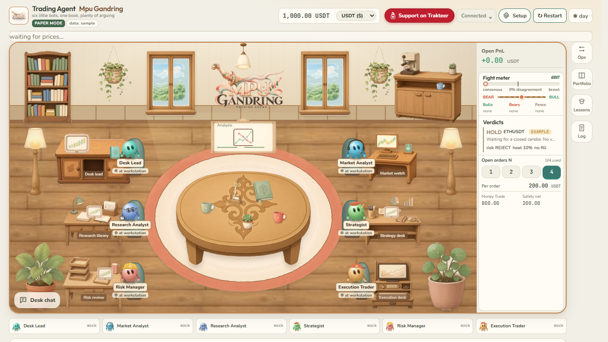
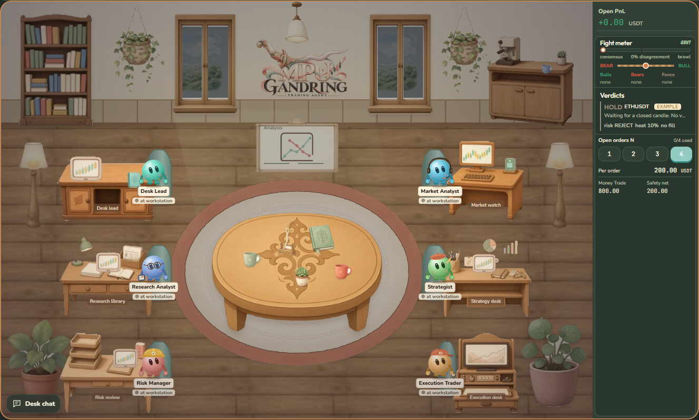
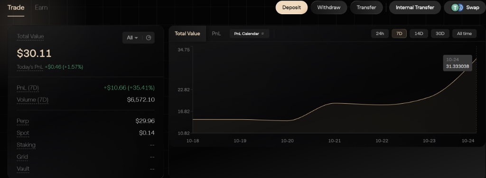
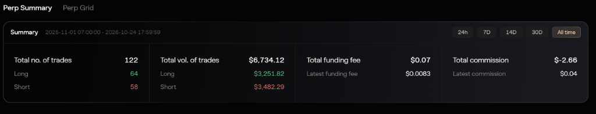
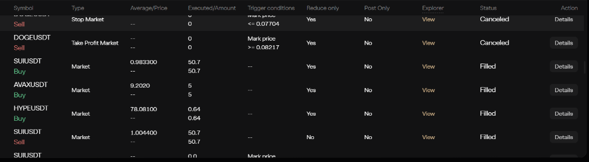
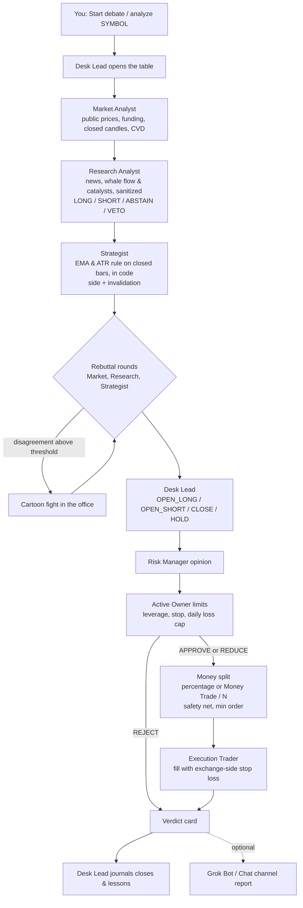
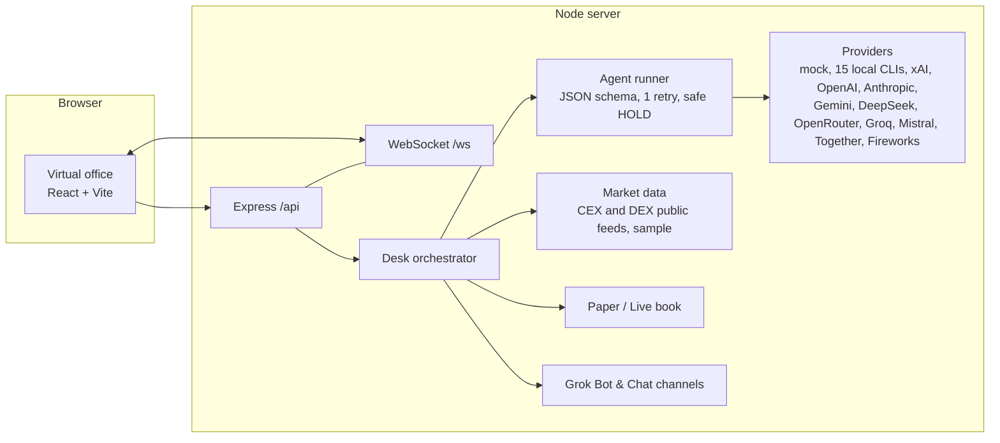

# Trading Agent Mpu Gandring

<p align="center">
  
</p>

<p align="center">
  <b>Version: v0.0.0.3.28 (package 0.3.28)</b> · <b>Node.js 20+</b> · <b>MIT License</b>
</p>

Six AI trading agents share one virtual office, backed by an optional Jev decision-intelligence sidecar (total architecture: **6 AI agents + Jev**; Jev is a sidecar, not a seventh trading agent). They read the market, argue about it, throw cartoon punches when they really disagree, and execute the Desk Lead's decision using the Owner's profile and allocation.

You watch all of it live in an illustrated virtual office in your browser, and you can walk up to any agent to talk to them or give direct orders.





*Screenshots use isolated PAPER/mock fixtures and simulated data. They demonstrate the interface, not exchange execution or trading results.*

> **Risk warning. Paper trading by default. Not financial advice. No profit promised.** This is an educational project about multi-agent decision making. If you choose TESTNET or LIVE in setup, the agents trade **on their own** in full auto with no approval step: they open, close, size and set stops without asking you. In LIVE that is real money and you can lose it, quickly. Automatic guards including the no-withdraw key check, stop on every order, daily loss stop, safety net, max N and kill switch limit damage; they do not prevent losses. Read [docs/live-trading.md](docs/live-trading.md) first.

---

## Table of Contents

1. [Fastest Installation (3 Steps)](#1-fastest-installation-3-steps)
2. [What's New in v0.0.0.3.28](#2-whats-new-in-v000328)
3. [Verified Live Trading Results (Aster Perp DEX)](#3-verified-live-trading-results-aster-perp-dex)
4. [Two Ways to Run It (Local Mode vs Grok Bot Mode)](#4-two-ways-to-run-it-local-mode-vs-grok-bot-mode)
5. [Step-by-Step Setup Guide (Models, Keys & Venues)](#5-step-by-step-setup-guide-models-keys--venues)
6. [Owner Trading Profiles & Money Split](#6-owner-trading-profiles--money-split)
7. [CLI & Web Office Quick Reference](#7-cli--web-office-quick-reference)
8. [Supported Venues (CEX & Perp DEX)](#8-supported-venues-cex--perp-dex)
9. [Environment Configuration (`.env`)](#9-environment-configuration-env)
10. [How a Debate Flows & Architecture](#10-how-a-debate-flows--architecture)
11. [Talking to the Agents & Owner Commands](#11-talking-to-the-agents--owner-commands)
12. [Safety Notes & Going Live](#12-safety-notes--going-live)
13. [Repository Layout](#13-repository-layout)
14. [Panduan Bahasa Indonesia (Mulai Cepat)](#14-panduan-bahasa-indonesia-mulai-cepat)

---

## 1. Fastest Installation (3 Steps)

### Prerequisites
- **[Node.js 20 or newer](https://nodejs.org)** (`node -v`)
- **Git** (`git --version`)
- No API keys are required to start: the desk boots in **PAPER** mode with a deterministic offline `mock` provider out of the box.

### Step 1: Clone & Install

**Windows (PowerShell) / macOS / Linux:**
```bash
git clone https://github.com/aabrur/trading-agent-mpu-gandring.git
cd trading-agent-mpu-gandring
npm install
```

### Step 2: Register the `mpu` Launcher (One-Time)
```bash
npm link
```

### Step 3: Launch the Virtual Office
```bash
mpu
```

That's it! Typing `mpu` from any terminal builds the project if needed, starts the backend (`http://127.0.0.1:8787`) and web UI (`http://127.0.0.1:5173`), and opens the virtual office in your browser.

| Useful Launch Commands | What It Does |
| --- | --- |
| `mpu` | Starts the desk and opens the virtual office in your browser |
| `mpu setup` | Starts the desk and opens **Setup** (`http://127.0.0.1:5173/#setup`) directly |
| `npm run dev` | Starts backend + frontend in development watch mode with hot reload |
| `npm run setup` | Interactive terminal setup wizard (hidden key prompts, chmod 600 `.env`) |
| `npm run doctor` | Verifies configuration and every configured API/venue key without printing secrets |
| `npm run trade` | Builds if needed and starts backend + office with full **Auto Trade ON** |

---

## 2. What's New in v0.0.0.3.28

- **Instant Venue Switching in Setup (`Setup > Exchange & Safety`)**: Selecting any exchange (`Bybit`, `OKX`, `Binance`, `Hyperliquid`, `Aster`, `dYdX v4`, `Paradex`, `Orderly`) from the dropdown immediately persists `EXCHANGE` to `.env`, updates runtime desk state in-place, opens the credential form, and switches all input fields (`guide.fields`) and status lines (`testnet` and `mainnet`) to the selected exchange.
- **Partial Credential Merging (`saveVenueKeys`)**: If one credential field (such as `BYBIT_API_KEY`) is already saved and you only enter the missing field (such as `BYBIT_API_SECRET`), the backend merges your input with the existing stored credential before verifying permissions on the exchange. Failed saves keep your typed input intact and show feedback directly under the Save button.
- **Zero Minimum Trade Default (`MIN_ORDER_USDT = 0`)**: Default minimum order notional (`minOrderUsdt` / `MIN_ORDER_USDT`) is now `0` USDT across trading profiles and `planOrder`, so small allocations are never blocked by an artificial app floor (exchange-published `minQty` and `minNotional` rules still apply when provided by the venue).
- **Clean TopBar Header & Active Venue Priority**: Removed redundant `CEX · Bybit`, `V`, and `data: <source>` badges from the top bar, and prioritized live server venue state (`state.venue.name`) over stale `localStorage` entries so balance checks never get stuck on a previous venue.
- **HUD Readability & Compact Verdicts Expansion**: Enhanced compact status metrics with larger readable typography and enlarged compact verdict history to 3 cards for immediate at-a-glance decision tracking.
- **Jitter-Free Workspace Tools Flyout**: Eliminated scrollbar freezing layout thrashing on Windows and added automatic collision avoidance with agent chat.
- **Streamlined Agent Chat & Deduplication**: High-speed, structured 1-on-1 agent replies with executive summaries first, zero unnecessary handoff delays for direct conversations, and clean message deduplication.
- **Expanded Local CLI Agents Catalog (15 Agents) & External Supervisors (7 Agents)**: Direct integration with Codex, Claude Code, Pi, Kimi Code, Kilo, Cline, Grok Build, Antigravity, Hermes Agent, OpenClaw, GitHub Copilot CLI, Cursor Agent, Qwen Code, OpenCode, and Muse Code, plus external supervision cards for Grok Bot, Claude Cowork / Desktop, Dot, Muse, ChatGPT Agent, Manus, and Perplexity Comet.

---

## 3. Verified Live Trading Results (Aster Perp DEX)

Real money live execution on Aster perpetual DEX showing verified net profitability in full auto mode:

<p align="center">
  
</p>

- **Net Profit**: +$10.66 (+35.41% ROI) in 4 days of continuous live operation.
- **Account Equity**: Grew from initial capital to $30.11 with a steady upward equity curve.
- **Total Trading Volume**: $6,734.12 across 122 completed trades.

<p align="center">
  
</p>

- **Balanced Two-Way Execution**: 64 Longs and 58 Shorts. The agents adapt dynamically to market regimes instead of running one-directional bias.
- **Strict Risk Compliance**: Zero liquidated positions, disciplined profit realization, and consistent fee coverage.

<p align="center">
  
</p>

- **Exchange-Side Stop Losses**: Every order (SUI, AVAX, HYPE, DOGE) rests verifiable trigger stops directly on exchange contracts.
- **Execution Authenticity**: Clean order logs demonstrating Market, Stop Market, and Take Profit executions with filled contracts and zero address exposure.

---

## 4. Two Ways to Run It (Local Mode vs Grok Bot Mode)

| Feature | Local Mode (Default) | Grok Bot Mode |
| --- | --- | --- |
| **Where it runs** | On your own computer (`127.0.0.1`) | On Grok Bot's cloud computer (your laptop can stay off) |
| **Who plays the 6 agents** | API models (OpenRouter, OpenAI, Anthropic, xAI, Gemini, DeepSeek, Groq, Mistral, Together, Fireworks) or 15 Local CLI Agents on your PC | Your own 6 Grok Bot employee agents in one group chat |
| **How turns arrive** | The local server calls your configured model APIs or local CLIs | Grok Bot employees post through `npm run gb` on that machine |
| **Setup command** | `mpu setup` or `npm run setup` | Grok Bot follows [grokbot/BOOTSTRAP.md](grokbot/BOOTSTRAP.md) |
| **Full guide** | [docs/local-mode.md](docs/local-mode.md) | [grokbot/INSTALL.md](grokbot/INSTALL.md) |

### One-Click Grok Bot Install
Open the [Trading Agent Mpu Gandring template](https://x.ai/bot/fX91UALWOlFMk_Oj2LBjn) and add it to your Grok Bot. It creates the six employees (`Desk Lead`, `Market Analyst`, `Research Analyst`, `Strategist`, `Risk Manager`, `Execution Trader`) and their group chat, then walks you through the one-time setup using Grok Bot's secret request card. See [grokbot/INSTALL.md](grokbot/INSTALL.md).

---

## 5. Step-by-Step Setup Guide (Models, Keys & Venues)

You can configure everything either in the **Web Office UI** (`http://localhost:5173/#setup`, click **Setup** at the top right) or in the **Terminal** (`npm run setup`). Both use the exact same backend (`server/setup/*`) and write to your local `.env` file (`chmod 600`).

### Step A: Choose Your AI Brains (`Setup > Models` or `Setup > Local Agents`)
1. **Free Offline Demo (`mock`)**: Works immediately with zero keys.
2. **Cloud Model APIs (10 Providers, 20 Models each)**: Enter one or more API keys in **Setup > Models** (`OpenRouter`, `xAI`, `OpenAI`, `Anthropic`, `Gemini`, `DeepSeek`, `Groq`, `Mistral`, `Together`, `Fireworks`). One API key (for example `OPENROUTER_API_KEY`) can power all 6 agents with different frontier models, or you can mix providers per agent.
3. **Local CLI Agents (15 Agents)**: Open **Setup > Local Agents** to use a CLI already signed in on your computer (`Codex`, `Claude Code`, `Pi`, `Kimi Code`, `Kilo`, `Cline`, `Grok Build`, `Antigravity`, `Hermes Agent`, `OpenClaw`, `GitHub Copilot CLI`, `Cursor Agent`, `Qwen Code`, `OpenCode`, `Muse Code`).

### Step B: Connect an Exchange or DEX Wallet (`Setup > Exchange & Safety`)
Always start in **PAPER**, then test on **TESTNET**, and switch to **LIVE** only when you are ready.

1. Open **Setup > Exchange & Safety** (or click **Edit** if viewing the summary).
2. **Select your Venue & Network (`testnet` or `mainnet`)**:
   - **CEX (`Bybit`, `Binance`, `OKX`)**: Selecting the exchange in the dropdown immediately updates the credential inputs below to match that exchange (`BYBIT_API_KEY` + `BYBIT_API_SECRET`, `OKX_API_KEY` + `OKX_API_SECRET` + `OKX_API_PASSPHRASE`, etc.). Paste your **trade-only** API key and secret (Withdrawals and Transfers **MUST be OFF**) and click **Save keys**.
   - **DEX (`Hyperliquid`, `Aster`, `dYdX v4`, `Paradex`, `Orderly`)**: For **Hyperliquid** and **Aster**, click the green **Connect Wallet** button in the top bar (or inside Setup) to approve a fresh trade-only agent wallet with one signature from MetaMask, Rabby, or Phantom EVM. Or enter your delegated agent/subkey credentials in the form.
3. **Verify (`Run doctor`)**: Click **Run doctor** (or run `npm run doctor` in terminal). It performs a harmless read check and confirms that your key **can trade** and **cannot withdraw**.
4. **Switch Mode (`PAPER` / `TESTNET` / `LIVE`)**: Select your desired mode and click **Save mode** (switching to `LIVE` requires typing `"I understand LIVE trades real money"`). Click **↻ Restart** in the top bar to apply in-place.

> **Security Rule:** Never paste API keys, private keys, or seed phrases into any chat window. Keys go only into the masked Setup inputs or directly into your local `.env` file. Main wallet private keys, seed phrases, and keys with withdrawal permissions are automatically refused.

---

## 6. Owner Trading Profiles & Money Split

### Four Risk Presets (`Setup > Trading` or `Desk Ops`)

| Profile | Stop Loss (of Margin) | Take Profit (of Margin) | Max Leverage | Entry Confidence Floor | Daily Loss Limit | Max Positions (`N`) |
| --- | --- | --- | --- | --- | --- | --- |
| **Default** | 20% | 60% | 5x | 60% | 10% | 3 |
| **Balance** | 30% | 60% | 10x | 60% | 15% | 3 |
| **Profit** | 40% | 70% | 15x | 60% | 20% | 2 |
| **Aggressive** | 50% | 80% | 20x | 60% | 25% | 2 |

- **Margin-Based SL/TP**: Stop loss and take profit percentages are calculated on committed order margin. For example, **Default** at `5x` leverage places the stop at `4%` price distance (`20% / 5`) and take profit at `12%` price distance (`60% / 5`) from entry.
- **Preserved Capital Settings**: Switching presets updates risk/leverage parameters while preserving your account `safetyNet`, `minOrderUsdt` (default `0`), and custom `orderSizePct`. See [docs/setup/trading-profiles.md](docs/setup/trading-profiles.md).

### Boss's Money Split Rule

```text
Money Trade          = Total Balance - Safety Net
Allocation per order = Money Trade * (orderSizePct / 100)   when orderSizePct is set (1.5% to 100%)
Allocation per order = Money Trade / N                     otherwise (N = 1, 2, 3, or 4)
```

- **Example**: With `100 USDT` balance, `20 USDT` safety net, and `N = 4`, **Money Trade** is `80 USDT` and each order gets `20 USDT` margin. The `20 USDT` safety net is never touched.
- Full details: [docs/money-split.md](docs/money-split.md).

---

## 7. CLI & Web Office Quick Reference

Everything can be done in the terminal or in the browser office through the same shared code:

| Action | Terminal (CLI) | Web Office UI (`http://localhost:5173`) |
| --- | --- | --- |
| Start the desk & open UI | `mpu` or `npm run dev` | Opens automatically in browser |
| Open Setup wizard | `mpu setup` or `npm run setup` | **Setup** button (top right) or `/#setup` |
| Venue step-by-step guide | `npm run setup -- guide <venue> [--network mainnet]` | **Setup > Exchange & Safety** |
| Save exchange API keys | `npm run setup` (hidden input) | **Setup > Exchange & Safety** (masked inputs) |
| Connect DEX wallet + live balance | `npm run setup` | Green **Connect Wallet** button in top bar |
| Run Doctor / key check | `npm run doctor` | **Setup > Exchange & Safety > Run doctor** |
| Switch mode (`PAPER`/`TESTNET`/`LIVE`) | `npm run setup -- --yes --trading-mode testnet` | **Setup > Exchange & Safety > Save mode** |
| Check masked status | `npm run setup -- status` | **Setup > Exchange & Safety** status lines |
| View balance, equity & split | `npm run gb -- account`, `npm run gb -- split` | Top bar balance pill & **Portfolio** panel |
| Start a debate on any token | `npm run debate -- --symbol BTCUSDT` | **Start debate** button or `analyze BTCUSDT` |
| Auto Trade ON/OFF & Token Picker | `npm run trade` | **Desk Ops > Auto Trade** card |
| Size a ticket (read-only) | `npm run gb -- size BTCUSDT LONG 65000 64000` | **Desk Ops > Size ticket** |
| Open position (stop mandatory) | `npm run gb -- open BTCUSDT LONG --stop 64000` | **Desk Ops > Open with stop** |
| Close one or all positions | `npm run gb -- close BTCUSDT` / `close all` | **Portfolio** panel, **Desk Ops**, or `close all` |
| Run Proaktif scan | `npm run gb -- scan` | **Desk Ops > Proaktif scan** |
| View / add self-improving lessons | `npm run gb -- lessons list` | **Lessons** panel |
| Generate report now | `npm run gb -- report` | **Reports** panel **Report now** |
| Trigger Kill Switch | `curl -X POST http://127.0.0.1:8787/api/kill` | **Kill** button in command bar / **Desk Ops** |
| Release Kill Switch | `npm run unkill -- --yes` | **Unlock / Turn OFF** in **Desk Ops** |
| Configure Telegram / Discord / Slack / WhatsApp | `npm run channels -- setup <channel>` | **Setup > Channels** |

---

## 8. Supported Venues (CEX & Perp DEX)

| Venue | Kind | `EXCHANGE` Value | Adapter Status | Required Trade-Only Credentials (`.env`) |
| --- | --- | --- | --- | --- |
| **Bybit** | CEX | `bybit` | Implemented | `BYBIT_API_KEY` + `BYBIT_API_SECRET` (trade only, withdraw off) |
| **Binance** | CEX | `binance` | Experimental | `BINANCE_API_KEY` + `BINANCE_API_SECRET` (futures on, withdraw off) |
| **OKX** | CEX | `okx` | Experimental | `OKX_API_KEY` + `OKX_API_SECRET` + `OKX_API_PASSPHRASE` (trade only) |
| **Hyperliquid** | DEX | `hyperliquid` | Experimental | Connect Wallet (1-click agent approval) or `HYPERLIQUID_ACCOUNT_ADDRESS` + `HYPERLIQUID_AGENT_PRIVATE_KEY` |
| **Aster** | DEX | `aster` | Experimental | Connect Wallet (1-click agent approval) or `ASTER_USER_ADDRESS` + `ASTER_SIGNER_PRIVATE_KEY` |
| **dYdX v4** | DEX | `dydx` | Experimental | `DYDX_ADDRESS` + `DYDX_API_PRIVATE_KEY` + `DYDX_AUTHENTICATOR_ID` |
| **Paradex** | DEX | `paradex` | Experimental | `PARADEX_ACCOUNT_ADDRESS` + `PARADEX_SUBKEY_PRIVATE_KEY` |
| **Orderly** | DEX | `orderly` | Experimental | `ORDERLY_ACCOUNT_ID` + `ORDERLY_KEY_SECRET` |

- **Testnet variables** add `_TESTNET` after the venue prefix (for example `BYBIT_TESTNET_API_KEY`, `BYBIT_TESTNET_API_SECRET`).
- **Per-venue step-by-step guides**: See [docs/setup/README.md](docs/setup/README.md) ([Bybit](docs/setup/bybit.md), [Binance](docs/setup/binance.md), [OKX](docs/setup/okx.md), [Hyperliquid](docs/setup/hyperliquid.md), [Aster](docs/setup/aster.md), [dYdX](docs/setup/dydx.md), [Paradex](docs/setup/paradex.md), [Orderly](docs/setup/orderly.md)).
- **Exchange-Side Stops**: In `TESTNET` and `LIVE`, every position's stop loss rests directly on the exchange as a trigger order. If a stop cannot be confirmed on the exchange, the executor immediately closes the position (fail-closed).

---

## 9. Environment Configuration (`.env`)

All settings live in `.env` (copied from `.env.example` or managed automatically via **Setup**). Keys are read on the server only and never sent to the browser.

| Variable | Default | Description |
| --- | --- | --- |
| `TRADING_MODE` | `PAPER` | `PAPER`, `TESTNET`, or `LIVE`. `TESTNET`/`LIVE` verify keys on every startup. |
| `APP_MODE` | `local` | `local` or `grokbot` |
| `EXCHANGE` | `none` | Active venue: `bybit`, `binance`, `okx`, `hyperliquid`, `aster`, `dydx`, `paradex`, `orderly` |
| `MARKET_SOURCE` | `bybit` | Public market feed (`bybit`, `binance`, `hyperliquid`, `aster`, `dydx`, `paradex`, `orderly`, `sample`) |
| `WATCHLIST` | `BTCUSDT,ETHUSDT,SOLUSDT` | Default symbols in ticker strip and debate picker |
| `PAPER_BALANCE` | `1000` | Starting paper balance in USDT |
| `SAFETY_NET` | `200` | Reserved balance (USDT) that is never traded |
| `OPEN_ORDERS_N` | `4` | Max concurrent open positions (`1` to `4`) |
| `MIN_ORDER_USDT` | `0` | Fallback minimum order notional in USDT (`0` = no artificial app minimum; venue rules still apply) |
| `ORDER_SIZE_PCT` | unset | Optional per-order percentage of Money Trade (`1.5` to `100`). Unset uses `Money Trade / N` |
| `MAX_LEVERAGE` | `5` | Maximum leverage cap for the active Owner profile |
| `DEFAULT_STOP_PCT` | `20` | Stop loss percentage of committed order margin |
| `TAKE_PROFIT_PCT` | `60` | Take profit percentage of committed order margin |
| `MIN_ENTRY_CONFIDENCE_PCT` | `60` | Minimum reported confidence (`0..100`) required for autonomous entries |
| `DAILY_LOSS_LIMIT_PCT` | `10` | Daily loss stop (`0.5..25`% of day's starting equity) |
| `DEFAULT_PROVIDER` | `mock` | Default AI provider (`mock`, `local`, `openrouter`, `xai`, `openai`, `anthropic`, `gemini`, `deepseek`, `groq`, `mistral`, `together`, `fireworks`) |
| `AGENT_<ID>_PROVIDER` / `AGENT_<ID>_MODEL` | unset | Per-agent provider/model override (`LEAD`, `MARKET`, `RESEARCH`, `STRATEGIST`, `RISK`, `EXECUTION`) |
| `AUTO_TRADING` | `off` | `on` runs autonomous debate and execution cycles every `DEBATE_INTERVAL_MIN` minutes |
| `DEBATE_INTERVAL_MIN` | `15` | Minutes between autonomous trading cycles |
| `REPORT_INTERVAL_MIN` | `60` | Minutes between scheduled Desk Lead reports |
| `LEARNING` / `PROACTIVE_SCAN` | `on` / `on` | Enables `self-improving` lesson reflection and `proaktif-agent` pre-cycle scans |
| `HOST` / `PORT` / `WEB_PORT` | `127.0.0.1` / `8787` / `5173` | Bind address and ports (`LIVE` always enforces `127.0.0.1`) |

---

## 10. How a Debate Flows & Architecture





---

## 11. Talking to the Agents & Owner Commands

Click any agent in the office (`lead`, `market`, `research`, `strategist`, `risk`, `execution`) or use the command bar:

| Command | Effect |
| --- | --- |
| `analyze ETHUSDT`, `debate eth`, `cek sol` | Starts a full 6-agent debate on that symbol |
| `pause` / `resume`, `tahan` / `lanjut` | Pauses after current speaker / resumes debates |
| `set profile default\|balance\|profit\|aggressive` | Switches active Owner trading profile |
| `set n 3` | Sets max concurrent open positions (`1..4`) |
| `set safety 150` | Sets safety net in USDT |
| `set size 5%` | Sets per-order allocation percentage of Money Trade (`1.5%..100%`) |
| `set leverage 10` | Sets active leverage cap (`1..20`) |
| `open long BTC 5% 10`, `buy BTC` | Opens LONG directly through the shared executor with profile stop |
| `open short ETH 5% 10`, `sell ETH` | Opens SHORT directly through the shared executor with profile stop |
| `close BTC`, `close all` | Closes one or all open positions |
| `@all <message>` or `@market <message>` | Calls a multi-agent huddle or targets a specific teammate |
| `status`, `help` | Shows current account, profile, and command summary |

---

## 12. Safety Notes & Going Live

- **`PAPER` by default**: `TESTNET` and `LIVE` start only when the exchange confirms the key can trade and cannot withdraw. Otherwise the server exits with code `2`.
- **Zero withdrawal code**: Keys with withdrawal permission, main wallet private keys, and seed phrases are refused both locally and on the exchange.
- **Mandatory Exchange-Side Stops**: Every order requires a stop loss resting on the exchange. No blind retries on failed orders; the book reconciles directly from exchange records.
- **Untrusted Data Sanitization**: News, social posts, TradingView webhooks, and lesson text are sanitized and fenced as untrusted data so prompt-injection attempts cannot trigger trades or loosen risk guards.
- Full live trading checklist: [docs/live-trading.md](docs/live-trading.md).

---

## 13. Repository Layout

```text
bin/mpu.mjs        One-command launcher: mpu, mpu setup, mpu --no-open
server/            Express + WebSocket backend
  agents/          Prompt loader, multi-agent handoffs, and JSON-validated agent runner
    personas/      Six agent folders, each with identity.md, soul.md, role.md and agent.md
  providers/       mock, OpenAI-compatible, Anthropic, Gemini, and 15 local CLI agent callers
  setup/           Shared setup routes, venue guides, model catalog, local agent status, preferences
  market/          Public market data, CVD microstructure, news & whale intelligence, sample data
  desk.ts          Debate orchestrator, commands, chat, runtime config reload
  money.ts         Money split and order planning (minOrderUsdt default 0)
  risk.ts          Code caps for the risk gate
  paper.ts         Paper book
  exchange/        Adapter interface; Bybit implemented; Binance, OKX, Hyperliquid, Aster, dYdX, Paradex, Orderly experimental
  live/            Automatic key guard, optional testnet round trip, live executor
  wallet.ts        Connect wallet: DEX agent key + one signed approval + live venue balance + deposit links
  updater.ts       In-app version check (v0.0.0.3.28) and one-click git fast-forward updater
  auto.ts          Full auto scheduler
  reports.ts       Periodic reports to files, UI, bridge and chat channels
  learnings.ts     self-improving lessons store
  scan.ts          proaktif-agent scan
cli/               CLI tools: setup.ts, doctor.ts, debate.ts, gb.ts, trade.ts, autostart.ts, bench-models.ts
grokbot/           Grok Bot cloud install: INSTALL.md, BOOTSTRAP.md, role prompts, learning skills
web/               Vite + React virtual office (Setup.tsx, Panels.tsx, Tour.tsx, UpdateModal.tsx, i18n.tsx)
tests/             Vitest test suite (67 test files, 651 tests)
docs/              Setup guides, live trading docs, architecture specs, and QA proofs
```

---

## 14. Panduan Bahasa Indonesia (Mulai Cepat)

Proyek ini berjalan dalam mode simulasi **PAPER** secara default. Enam agen AI berdebat (dan adu jotos kartun saat berbeda pendapat tajam), lalu mengeksekusi keputusan Desk Lead memakai profil risiko dan alokasi milik Anda. **Bukan saran keuangan dan tidak ada janji untung.**

### Cara Install Paling Mudah (3 Langkah)

1. Pastikan **[Node.js 20+](https://nodejs.org)** dan **Git** sudah terpasang di komputer Anda.
2. Buka terminal (PowerShell / Terminal) dan jalankan:
   ```bash
   git clone https://github.com/aabrur/trading-agent-mpu-gandring.git
   cd trading-agent-mpu-gandring
   npm install
   npm link
   ```
3. Jalankan perintah ini kapan saja untuk membuka kantor virtual:
   ```bash
   mpu
   ```
   *(Atau jalankan `npm run dev` untuk mode development).*

### Cara Setting Exchange & API Key (`v0.0.0.3.28`)

1. Klik tombol **Setup** di kanan atas Web UI (`http://localhost:5173/#setup`) atau ketik `mpu setup`.
2. Buka tab **Exchange & Safety** (klik **Edit** jika masih di tampilan ringkasan):
   - **Pilih Exchange di Dropdown**: Saat Anda memilih exchange apa pun (`Bybit`, `OKX`, `Binance`, `Hyperliquid`, `Aster`, `dYdX`, `Paradex`, `Orderly`), pengaturan `.env`, nama kolom input API Key/Secret di bawahnya, dan status `testnet`/`mainnet` akan **langsung berubah otomatis** mengikuti exchange yang dipilih.
   - **Masukkan API Key Khusus Trading**: Untuk CEX seperti Bybit, cukup centang izin **Read-Write** dan **Contract: Orders & Positions** di web Bybit (**Withdrawals & Subaccount Transfer WAJIB OFF**). Tempel API Key dan Secret ke kolom yang tersedia lalu klik **Save keys**. Jika salah satu kolom sudah tersimpan (`set`), Anda cukup mengisi kolom yang masih kosong (`empty`).
   - **DEX Connect Wallet**: Untuk DEX (`Hyperliquid`, `Aster`), Anda bisa langsung klik tombol hijau **Connect Wallet** di bagian atas layar untuk menyetujui *agent wallet* khusus trading hanya dengan 1x klik tanda tangan di MetaMask/Rabby.
3. Klik **Run doctor** (atau `npm run doctor` di terminal) untuk memastikan key Anda valid (**bisa trading, tidak bisa withdraw**).
4. Pilih mode (`PAPER`, `TESTNET`, atau `LIVE`) lalu klik **Save mode**.
5. Minimal trade (`MIN_ORDER_USDT`) kini bernilai default **`0`**, sehingga alokasi order kecil tidak lagi tertahan batas minimal aplikasi (selama memenuhi syarat lot minimum dari bursa).

---

## Contributing & Security

See [CONTRIBUTING.md](CONTRIBUTING.md). Security reports: [SECURITY.md](SECURITY.md).

## Credits & License

Price charts use [TradingView Lightweight Charts](https://github.com/tradingview/lightweight-charts) under Apache 2.0. Fonts are Nunito, Fredoka, JetBrains Mono and Bangers from Google Fonts.

MIT License, copyright 2026 Abrur Alaina. See [LICENSE](LICENSE).
