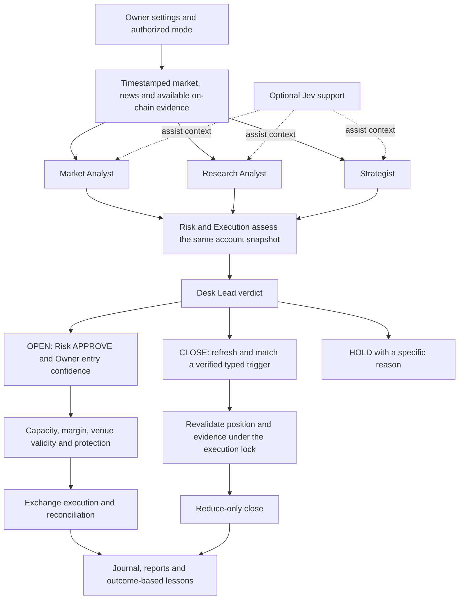

# Trading Agent Mpu Gandring

<p align="center">
  
</p>

**v0.0.0.4.12 · Six agent roles · PAPER / TESTNET / LIVE · MIT**

A trading desk that collects market evidence, runs a six-role debate, and executes eligible orders through exchange adapters. The Office brings together the discussion, positions, protection, reports and session history. You choose the models, venue and trading settings.

[Release v0.0.0.4.12](https://github.com/aabrur/trading-agent-mpu-gandring/releases/tag/v0.0.0.4.12) · [Public validation](https://github.com/aabrur/trading-agent-mpu-gandring/actions/workflows/ci.yml) · [Operational evidence](docs/live-evidence.md) · [Changelog](CHANGELOG.md)

A fresh installation starts in **PAPER**, uses mock agents, and leaves **Auto Trading off**. Exchange and model API keys are optional for getting started. Public market-data requests may still use the network.

## Install and open

Install [Node.js](https://nodejs.org/) and Git first. Node.js 24 matches the version used by this repository's CI.

**Windows PowerShell**

```powershell
git clone https://github.com/aabrur/trading-agent-mpu-gandring.git
cd trading-agent-mpu-gandring
npm.cmd ci
node bin/mpu.mjs
```

**macOS / Linux**

```sh
git clone https://github.com/aabrur/trading-agent-mpu-gandring.git
cd trading-agent-mpu-gandring
npm ci
node bin/mpu.mjs
```

The first launch builds the application, creates a local PAPER configuration, and opens **[http://127.0.0.1:8787/#setup](http://127.0.0.1:8787/#setup)**. The built Office and backend share port `8787` by default. A later launch reuses your saved configuration.

No global installation is required. From the project directory, run `node bin/mpu.mjs` again whenever you want to open the Office. Keep that terminal running while you use the desk.

Optional: run `npm link` once to register the shorter `mpu` command. On Windows, use `npm.cmd link` if PowerShell blocks `npm.ps1`.

## First setup

1. Open **Setup** in the Office.
2. Keep **PAPER** selected while you explore. Mock agents work without model keys; connect your model provider or an installed local agent when ready.
3. Choose the paper balance, capital reserve, position count, and other settings yourself.
4. Use **Start debate** or enter `analyze BTCUSDT` in the command bar.
5. Open **Log → Archived sessions** to inspect the current run or a previous session. Trade and conversation history remain in **History**.

The terminal wizard is available through `npm run setup`. If you installed the optional global command, `mpu setup` opens that terminal wizard.

Enter credentials through the hidden terminal prompts or masked Setup fields. Never paste keys into chat or commit them. Use trade-only credentials with withdrawal and transfer permissions disabled; never provide a main wallet private key or seed phrase.

For a venue account, follow the [venue setup guide](docs/setup/README.md), run `npm run doctor`, and verify TESTNET before choosing LIVE. **LIVE uses real money and can lose it.** When Auto Trading is enabled, decisions can execute without per-order approval. Read [live trading](docs/live-trading.md) before enabling it.

## The current workflow



**OPEN:** actual Lead confidence must meet the saved Owner Minimum Entry Confidence, Risk must approve, and execution guards must pass. Templates do not add another confidence floor or silently change sizing.

**CLOSE:** Lead selects a genuine verified exit trigger for an actual managed position. Evidence is refreshed after deliberation and checked again under the execution lock. The 30-second freshness limit stays in place. Full slots, entry margin and entry confidence do not veto a valid CLOSE. An opposite signal does not automatically reverse the position.

| Role | Responsibility |
| --- | --- |
| Desk Lead | Weigh completed specialist replies and record one verdict |
| Market Analyst | Price structure, measured momentum, order flow and data quality |
| Research Analyst | Sourced catalysts, available on-chain evidence and provenance |
| Strategist | Entry scenario, structural invalidation and the opposing case |
| Risk Manager | Entry admission separately from management of existing positions |
| Execution Trader | Venue readiness, exchange protection, submission and reconciliation |

## Jev's role

Jev is an **optional decision-support sidecar** through OpenRouter. It can classify the supplied market regime, assess news relevance and contradictions, and help prioritize data collection alongside the six roles.

| Mode | Effect |
| --- | --- |
| `off` | No Jev analysis; the default |
| `shadow` | Record background observations without enriching agents' decision context |
| `assist` | Supply bounded context to specialists and the collection workflow |

LIVE assist additionally requires explicit `JEV_ALLOW_LIVE` permission. Without it, configured assist becomes shadow in LIVE. Remote, cached, unavailable and local heuristic fallback results are labeled separately. A fallback does not prove that the remote Jev model answered.

Jev does not place orders, approve Risk, change Owner settings or bypass exchange guards. Enable it through Setup only when wanted. Configuration alone does not prove connectivity. See [Jev integration](server/decision/jev.ts) and [decision evaluation](server/decision/evaluation.ts).

## Choose where the team runs

| Environment | Installation and operation |
| --- | --- |
| Your computer | Use the launcher above. Connect cloud models, including DeepSeek, or supported local agent CLIs in Setup |
| Grok Bot's own computer | [Template](grokbot/TEMPLATE.md) and [bootstrap](grokbot/BOOTSTRAP.md) create or reuse six native agents and one group |
| Muse's own computer | [Template](muse/muse-template.md) and [manual](muse/MUSE.md) use main Muse as Lead plus five independent native peers |

External teams use their platform's agents for reasoning and the same backend for data, sizing, execution, protection and reporting. Follow the [shared operating contract](docs/external-agent-operations.md). Choose one Owner-authorized driver per desk, preserve settings on upgrades, and verify actual native-agent/group creation on the platform.

### Venue support

Bybit has the implemented non-experimental adapter contract and mocked exchange coverage. Binance, OKX, Hyperliquid, Aster, dYdX, Paradex and Orderly remain experimental. dYdX also needs its additional SDK. Follow the [per-venue setup guides](docs/setup/README.md); these repository labels are not independent account certification.

Existing exchange protections and startup permission checks remain in place. Confirm the actual exchange-side stop status for your positions; an unavailable verification result is not confirmation.

## Daily use

| Action | How |
| --- | --- |
| Open the built Office | `node bin/mpu.mjs` |
| Open without launching a browser | `node bin/mpu.mjs --no-open` |
| Configure models, venue, mode, or channels | **Setup**, or `npm run setup` |
| Inspect masked configuration | `npm run setup -- status` |
| Check configured permissions/connectivity | `npm run doctor` |
| Read account / positions | `npm run gb -- account --json` / `npm run gb -- positions --json` |
| Generate a report | **Reports → Report now**, or `npm run gb -- report` |
| Read the same formatted chat reports | `npm run gb -- summary status`, `summary positions`, `summary scan`, `summary scorecard` |
| Inspect fresh exit evidence | `npm run gb -- close-review BTCUSDT --trigger MOMENTUM_REVERSAL --json` |
| Read persistent diagnostics | **Log → Archived sessions** |
| Pause debate activity | `pause`; this does not close positions |
| Close positions | **Close all** or the position controls |
| Emergency action | **Kill**; distinct from Pause, Close all, and ordinary server shutdown |
| Release emergency kill | **Local Office OFF button** or **mpu unkill**; clears the persistent latch without placing an order or enabling Auto Trading |
| Check version and health | **mpu version** (--json, --short, -v) / **mpu health** |
| Global CLI shortcut link | **mpu link** (or **npm link**); makes mpu executable from any folder |
| Account money trade allocation | **mpu split** |
| Market and research queries | **mpu market <sym>**, **mpu research <tool> <sym>**, **mpu backtest <sym>** |

`npm run trade` starts the trading supervisor. In local mode, it **forces Auto Trading on for that run** and uses the saved trading mode. In Grok Bot mode, it starts the Office for the remote team. It is not needed for the first-run walkthrough.

Ctrl+C stops the launcher/server. It does not invoke the Kill Switch. Position protection and exchange-side outcomes must be checked separately.

## Operational evidence and profit claims

The repository implements exchange orders, reconciliation and protection in its [execution engine](server/live/executor.ts). The release's privacy-preserving audit found **retained mainnet execution records and positive exchange-reported realized PnL matched to engine close intents**.

This supports a record-level statement that those mainnet records contain positive realized-PnL closes. The source is owner-retained local evidence, without independent exchange attestation. **Complete net profitability after all fees and funding remains unverified.** Individual positive outcomes do not establish profitable overall performance or future returns.

Read the [dated evidence statement and reproducible audit](docs/live-evidence.md). Public evidence excludes amounts, balances, symbols, addresses, account/order identifiers, credentials and raw operational files. Offline tests demonstrate software behavior and are reported separately from LIVE records.

## Credentials and privacy

- Enter keys only through hidden prompts, masked Setup or the platform's approved secret flow. Never paste them into chat, issues, source files or release notes.
- Use delegated trade-only credentials. Main-wallet private keys, seed phrases and withdrawal/transfer permissions are refused.
- `.env`, execution/financial journals, conversations, diagnostic sessions, reports and local operational audits stay outside Git. `.env.example` contains configuration names and empty/example values.
- Review screenshots and exports before sharing. Keep the Office loopback-bound in LIVE.
- Publication checks include the public file tree, reachable Git history and private exact-value comparisons against local secrets/identifiers. Synthetic test credentials are reviewed separately.

See [session logs](docs/session-logs.md) for archive storage and [security reporting](SECURITY.md) for private disclosure.

## Development and verification

```sh
npm run dev
```

Development uses two services: Office at `http://127.0.0.1:5173`, backend at `http://127.0.0.1:8787`. Open the Office URL yourself. This differs from the single-port built launcher.

```sh
npm run stage-gate -- --stage S5
npm run evidence:live
```

The stage gate executes isolated typecheck, tests and production build once and saves its evidence outside operational data. Historical roadmap PASS files do not establish the current result. `evidence:live` reads your retained records offline and returns privacy-preserving flags; it never contacts a venue or places an order. A fresh install normally has no observed mainnet records.

The Python statistical worker tests require a working `python` command. Running the desk does not require activating that worker.

For the isolated archive browser check, see [session-log verification](docs/session-logs.md). Keep production credentials and an active trading process separate from development and test runs.

To update an installation, choose a maintenance window, then use `git pull --ff-only`, `npm ci`, and `npm run build` before starting the updated desk. Do not replace files underneath an active watched trading process.

## Guides

- [Local model setup and operation](docs/local-mode.md)
- [Installed local agent CLIs](docs/local-agents.md)
- [Venue setup](docs/setup/README.md)
- [Trading settings](docs/setup/trading-profiles.md)
- [Live trading and exchange protections](docs/live-trading.md)
- [Channels: Telegram, Discord, Slack, WhatsApp](docs/channels.md)
- [Grok Bot mode](docs/grokbot-mode.md) and [installation on the bot's computer](grokbot/INSTALL.md)
- [Native Muse installation](muse/muse-template.md) and [shared external-agent operations](docs/external-agent-operations.md)
- [Operational evidence](docs/live-evidence.md) and [financial accounting](docs/financial-history-capabilities.md)
- [Session logs](docs/session-logs.md)
- [Changelog](CHANGELOG.md)
- [Contributing](CONTRIBUTING.md) and [security reports](SECURITY.md)

## Mulai cepat

Pasang Node.js 24 dan Git, lalu jalankan perintah instalasi di atas. Untuk PowerShell, gunakan `npm.cmd ci`. Perintah `node bin/mpu.mjs` membangun aplikasi dan membuka Office di `http://127.0.0.1:8787`.

Instalasi baru memakai **PAPER**, agen mock, dan **Auto Trading mati**. `npm link` hanya pilihan untuk menambahkan perintah singkat `mpu`. Setup tersedia di Office atau lewat `npm run setup`; `mpu setup` adalah wizard terminal.

Pilih modal, model dan aturan trading sendiri. Isi kredensial hanya lewat input aman. Grok Bot dan Muse memakai komputer serta agent native masing-masing melalui template di atas. Bukti mainnet menunjukkan hasil realized PnL positif pada transaksi yang cocok dengan catatan engine; net profit lengkap setelah seluruh biaya belum terverifikasi. Nominal akun dan data transaksi privat tidak dipublikasikan.

## License and credits

[MIT](LICENSE), copyright 2026 Abrur Alaina. Charts use TradingView Lightweight Charts under Apache 2.0. Fonts include Nunito, Fredoka, JetBrains Mono, and Bangers.
