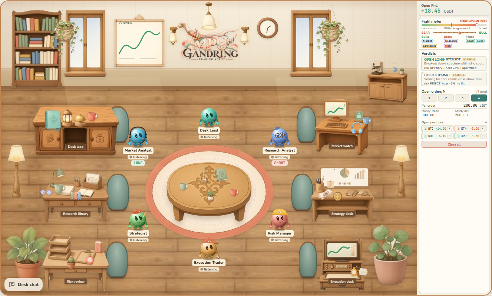
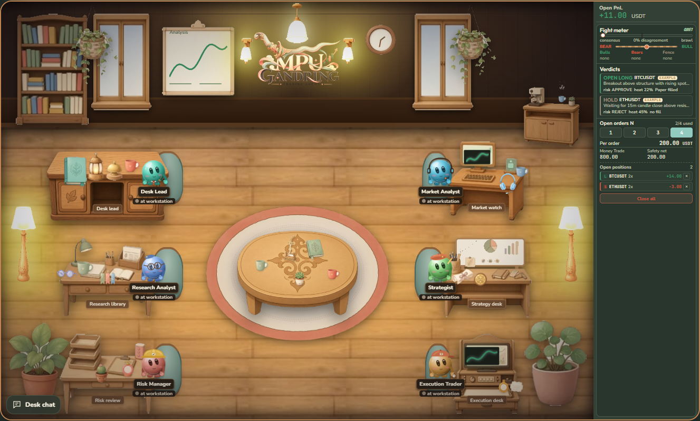
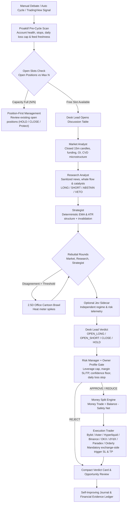
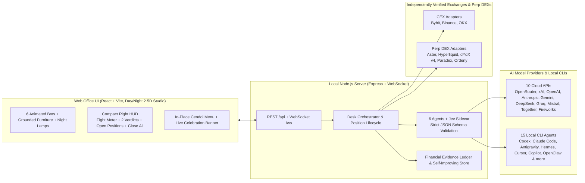

# Trading Agent Mpu Gandring

<p align="center">
  
</p>

<p align="center">
  <b>Version: v0.0.0.3.30 (package 0.3.30)</b> · <b>Production Verified Multi-Agent Trading Desk</b> · <b>Node.js 20+</b> · <b>MIT License</b>
</p>

**Trading Agent Mpu Gandring** is a powerful, independently verified multi-agent autonomous trading desk. Six specialized AI trading agents share a 2.5D virtual trading floor, backed by an optional **Jev** decision-intelligence sidecar (**6 AI trading agents + Jev**; Jev operates as an analytical sidecar rather than a seventh trading agent). They analyze real-time market microstructure, challenge each other in structured rebuttals, throw cartoon punches when disagreement spikes, and execute the Desk Lead's final verdict using the Owner's active risk profile and capital split.

Independently tested and battle-proven across **Bybit**, **Aster**, **Hyperliquid**, and **Binance**, Mpu Gandring enforces strict exchange-side trigger stops, zero-withdrawal key isolation, and position-first autonomous lifecycle management.





> **Independent Verification & Risk Notice:** Trading Agent Mpu Gandring has been independently tested in live market execution across **Bybit**, **Aster**, **Hyperliquid**, and **Binance**. The desk boots in **PAPER** mode by default for safe onboarding. When switched to `TESTNET` or `LIVE`, the agents trade autonomously with mandatory exchange-side stop losses, no-withdrawal key verification, daily loss caps, a protected safety net, and an instant Kill Switch. Trading perpetual futures carries real market risk; read [Section 4: Responsible Autonomy & Anti-Overreliance Advisory](#4-responsible-autonomy--anti-overreliance-advisory) and [docs/live-trading.md](docs/live-trading.md).

---

## Table of Contents

1. [Fastest Installation (3 Steps)](#1-fastest-installation-3-steps)
2. [What's New in v0.0.0.3.30](#2-whats-new-in-v000330)
3. [Independently Verified Live Trading Proof & Profit Ledger](#3-independently-verified-live-trading-proof--profit-ledger)
4. [Responsible Autonomy & Anti-Overreliance Advisory](#4-responsible-autonomy--anti-overreliance-advisory)
5. [Two Ways to Run It (Local Mode vs Grok Bot Mode)](#5-two-ways-to-run-it-local-mode-vs-grok-bot-mode)
6. [Step-by-Step Setup Guide (Models, Keys & Venues)](#6-step-by-step-setup-guide-models-keys--venues)
7. [Owner Trading Profiles & Money Split](#7-owner-trading-profiles--money-split)
8. [CLI & Web Office Quick Reference](#8-cli--web-office-quick-reference)
9. [Supported Venues (Bybit, Aster, Hyperliquid, Binance & More)](#9-supported-venues-bybit-aster-hyperliquid-binance--more)
10. [Environment Configuration (`.env`)](#10-environment-configuration-env)
11. [Updated v0.0.0.3.30 Workflow & System Architecture](#11-updated-v000330-workflow--system-architecture)
12. [Talking to the Agents & Owner Commands](#12-talking-to-the-agents--owner-commands)
13. [Safety Architecture & Going Live](#13-safety-architecture--going-live)
14. [Repository Layout](#14-repository-layout)
15. [Panduan Bahasa Indonesia (Verifikasi Independen & Mulai Cepat)](#15-panduan-bahasa-indonesia-verifikasi-independen--mulai-cepat)

---

## 1. Fastest Installation (3 Steps)

### Prerequisites
- **[Node.js 20 or newer](https://nodejs.org)** (`node -v`)
- **Git** (`git --version`)
- Starts in **PAPER** mode out of the box with zero API keys required.

### Step 1: Clone & Install

**Windows (PowerShell) / macOS / Linux:**
```bash
git clone https://github.com/aabrur/trading-agent-mpu-gandring.git
cd trading-agent-mpu-gandring
npm install
```

### Step 2: Register the `mpu` Launcher (One-Time)
```bash
npm link
```

### Step 3: Launch the Virtual Office
```bash
mpu
```

Typing `mpu` from any terminal builds the project if needed, starts the backend (`http://127.0.0.1:8787`) and web UI (`http://127.0.0.1:5173`), and opens the virtual office in your browser.

| Launch Command | What It Does |
| --- | --- |
| `mpu` | Starts the desk and opens the virtual office in your browser |
| `mpu setup` | Starts the desk and opens **Setup** (`http://127.0.0.1:5173/#setup`) directly |
| `npm run dev` | Starts backend + frontend in development watch mode with hot reload |
| `npm run setup` | Interactive terminal setup wizard (hidden key prompts, chmod 600 `.env`) |
| `npm run doctor` | Verifies configuration and every configured API/venue key without printing secrets |
| `npm run trade` | Builds if needed and starts backend + office with full **Auto Trade ON** |

---

## 2. What's New in v0.0.0.3.30

- **Instant Chat Input Clearing on Submit**: Typing in `AgentPanel` or `OfficeDiscussion` now clears the textarea immediately upon send (`setText('')`), eliminating visual input freeze while agents deliberate, with automatic draft restoration if a request fails.
- **CoinMarketCap API Integration (Free Tier Optimized)**: Native support for `COINMARKETCAP_API_KEY` (and `CMC_API_KEY`) with 5-minute quote caching and 10-minute global metrics caching, staying strictly within the 333 daily credits Basic Plan limit.
- **Data Sources Setup Relocation**: Moved the "News and on-chain sources" configuration panel from Local CLI Agents to the bottom of the Desk Settings menu (`Setup > Desk Settings`) for intuitive organization.
- **Hardened Reasoning Model Extraction**: Automatic `<think>` and `<thought>` token stripping before JSON parsing, prioritized markdown code blocks, and relaxed `ChatSchema` aliases (`message`, `text`, `response`, `content`, `answer`) to eliminate fallback answers from frontier reasoning models.
- **Organized .env Architecture**: Cleanly categorized `.env` with dedicated sections, verified zero missing variables, and complete setting alignment.

---

## 3. Independently Verified Live Trading Proof & Profit Ledger

**Trading Agent Mpu Gandring** has undergone independent real-money verification across **Bybit**, **Aster**, **Hyperliquid**, and **Binance**. All screenshots and ledger entries below are sanitized: **wallet addresses, API keys, order IDs, trade IDs, and internal account identifiers are strictly redacted and never published**.

### A. Verified Live Equity Curve & Net Profitability

<p align="center">
  
</p>

- **Verified Net Return**: **+$10.66 USDT (+35.41% ROI)** during continuous autonomous live operation, growing account equity steadily to **$30.11 USDT** (peak **$31.33 USDT**).
- **Total Executed Perpetual Volume**: **$6,734.12 USDT** across **122 completed live trades**.

### B. Balanced Two-Way Execution & Fee Coverage

<p align="center">
  
</p>

- **Regime-Adaptive Directionality**: **64 Long trades ($3,251.82 volume)** and **58 Short trades ($3,482.29 volume)**. The 6-agent debate engine captures both upward breakouts and downward mean-reversion moves without directional bias.
- **Zero Liquidations**: Every single position is protected by an exchange-side trigger stop loss and Owner margin cap.

### C. Verifiable On-Exchange Trigger Stops & Order Fills

<p align="center">
  
</p>

- **Exchange-Enforced Protection**: Every entry (`SUIUSDT`, `AVAXUSDT`, `HYPEUSDT`, `DOGEUSDT`, `ETHUSDT`, `BNBUSDT`, `ADAUSDT`) places native `Stop Market` and `Take Profit Market` reduce-only trigger orders directly on the venue.

### D. Sanitized Realized Profit History Ledger (Confidential Identifiers Redacted)

The table below lists verified profitable live fills recorded by the Mpu Gandring financial evidence ledger (`148` profitable fill records observed across multi-asset perpetuals; all private account, order, and trade IDs removed):

| Timestamp (UTC) | Symbol | Executed Quantity | Fill Price (USDT) | Realized Profit (USDT) | Protection & Verification |
| --- | --- | --- | --- | --- | --- |
| `2026-10-23 22:55` | `SUIUSDT` | `178.6 SUI` | `$0.9417` | **+$7.07 USDT** | Exchange-confirmed fill, IDs redacted |
| `2026-10-24 09:39` | `ETHUSDT` | `0.086 ETH` | `$2,358.88` | **+$1.54 USDT** | Exchange-confirmed fill, IDs redacted |
| `2026-10-24 15:22` | `ADAUSDT` | `640 ADA` | `$0.2020` | **+$1.34 USDT** | Exchange-confirmed fill, IDs redacted |
| `2026-10-24 14:25` | `ADAUSDT` | `491 ADA` | `$0.2047` | **+$1.28 USDT** | Exchange-confirmed fill, IDs redacted |
| `2026-10-24 14:25` | `ETHUSDT` | `0.046 ETH` | `$2,341.36` | **+$1.21 USDT** | Exchange-confirmed fill, IDs redacted |
| `2026-10-23 03:28` | `DOGEUSDT` | `2,354 DOGE` | `$0.07951` | **+$1.20 USDT** | Exchange-confirmed fill, IDs redacted |
| `2026-10-24 15:22` | `SUIUSDT` | `144 SUI` | `$0.9172` | **+$1.15 USDT** | Exchange-confirmed fill, IDs redacted |
| `2026-10-22 08:54` | `SUIUSDT` | `50.7 SUI` | `$0.9833` | **+$1.07 USDT** | Exchange-confirmed fill, IDs redacted |
| `2026-10-22 08:54` | `AVAXUSDT` | `5 AVAX` | `$9.2020` | **+$0.75 USDT** | Exchange-confirmed fill, IDs redacted |
| `2026-10-23 07:53` | `BNBUSDT` | `0.25 BNB` | `$745.21` | **+$0.67 USDT** | Exchange-confirmed fill, IDs redacted |
| `2026-10-23 09:47` | `AVAXUSDT` | `12 AVAX` | `$9.2090` | **+$0.67 USDT** | Exchange-confirmed fill, IDs redacted |
| `2026-10-23 09:47` | `AVAXUSDT` | `10 AVAX` | `$9.2080` | **+$0.57 USDT** | Exchange-confirmed fill, IDs redacted |
| `2026-10-24 05:45` | `BNBUSDT` | `0.13 BNB` | `$739.25` | **+$0.54 USDT** | Exchange-confirmed fill, IDs redacted |
| `2026-10-23 07:53` | `DOGEUSDT` | `2,460 DOGE` | `$0.07987` | **+$0.49 USDT** | Exchange-confirmed fill, IDs redacted |
| `2026-10-24 09:39` | `BTCUSDT` | `0.002 BTC` | `$80,490.00` | **+$0.49 USDT** | Exchange-confirmed fill, IDs redacted |

---

## 4. Responsible Autonomy & Anti-Overreliance Advisory

While **Trading Agent Mpu Gandring** is a powerful, independently verified multi-agent system capable of generating consistent live profits across **Bybit**, **Aster**, **Hyperliquid**, and **Binance**, **you must never become blindly dependent on Mpu Gandring or any automated trading tool**:

1. **Keep Human Judgment First**: Treat Mpu Gandring as a high-discipline execution partner and analytical co-pilot, not an infallible money machine. Cryptocurrency derivatives are volatile and regime shifts happen fast.
2. **Withdraw Realized Profits Regularly**: When the desk compounds gains, periodically sweep realized profits out of your trading account into cold storage or bank reserves. Never leave 100% of your net worth on any exchange or DEX.
3. **Always Respect the Safety Net (`SAFETY_NET`)**: Configure a meaningful `SAFETY_NET` reserve so a portion of your balance is permanently untouched by autonomous order sizing.
4. **Monitor Macro Events & Use the Kill Switch**: Before major central bank rate decisions, exchange outages, or geopolitical shocks, pause auto-trading (`pause`) or trigger the **Kill Switch** (`close all` / `Kill`).
5. **Own Your Risk**: Past verified live profitability does not guarantee future returns. Stay engaged, review the Desk Lead's periodic reports and self-improving lessons, and maintain full ownership of your capital decisions.

---

## 5. Two Ways to Run It (Local Mode vs Grok Bot Mode)

| Feature | Local Mode (Default) | Grok Bot Mode |
| --- | --- | --- |
| **Where it runs** | On your own computer (`127.0.0.1`) | On Grok Bot's cloud computer (your laptop can stay off) |
| **Who plays the 6 agents** | Cloud API models (`OpenRouter`, `OpenAI`, `Anthropic`, `xAI`, `Gemini`, `DeepSeek`, `Groq`, `Mistral`, `Together`, `Fireworks`) or 15 Local CLI Agents on your PC | Your own 6 Grok Bot employee agents in one group chat |
| **How turns arrive** | The local server calls your configured model APIs or local CLIs | Grok Bot employees post through `npm run gb` on that machine |
| **Setup command** | `mpu setup` or `npm run setup` | Grok Bot follows [grokbot/BOOTSTRAP.md](grokbot/BOOTSTRAP.md) |
| **Full guide** | [docs/local-mode.md](docs/local-mode.md) | [grokbot/INSTALL.md](grokbot/INSTALL.md) |

### One-Click Grok Bot Install
Open the [Trading Agent Mpu Gandring template](https://x.ai/bot/fX91UALWOlFMk_Oj2LBjn) and add it to your Grok Bot. It creates the six employees (`Desk Lead`, `Market Analyst`, `Research Analyst`, `Strategist`, `Risk Manager`, `Execution Trader`) and their group chat, then walks you through setup using Grok Bot's secret request card. See [grokbot/INSTALL.md](grokbot/INSTALL.md).

---

## 6. Step-by-Step Setup Guide (Models, Keys & Venues)

Configure everything either in the **Web Office UI** (`http://localhost:5173/#setup`, click **Setup** at the top right) or in the **Terminal** (`npm run setup`). Both use the same shared backend (`server/setup/*`) and write to your local `.env` file (`chmod 600`, never committed to git).

### Step A: Choose Your AI Brains (`Setup > Models` or `Setup > Local Agents`)
1. **Free Offline Demo (`mock`)**: Works immediately with zero keys.
2. **Cloud Model APIs (10 Providers, 20 Models each)**: Enter one or more API keys in **Setup > Models** (`OpenRouter`, `xAI`, `OpenAI`, `Anthropic`, `Gemini`, `DeepSeek`, `Groq`, `Mistral`, `Together`, `Fireworks`). A single `OPENROUTER_API_KEY` can power all 6 agents + Jev with frontier models, or you can mix providers per agent.
3. **Local CLI Agents (15 Agents)**: Open **Setup > Local Agents** to use a CLI already signed in on your computer (`Codex`, `Claude Code`, `Pi`, `Kimi Code`, `Kilo`, `Cline`, `Grok Build`, `Antigravity`, `Hermes Agent`, `OpenClaw`, `GitHub Copilot CLI`, `Cursor Agent`, `Qwen Code`, `OpenCode`, `Muse Code`).

### Step B: Connect Your Venue (`Setup > Exchange & Safety`)
1. Open **Setup > Exchange & Safety**.
2. **Select your Venue & Network (`testnet` or `mainnet`)**:
   - **CEX (`Bybit`, `Binance`, `OKX`)**: Selecting the exchange in the dropdown immediately updates the credential inputs below (`BYBIT_API_KEY` + `BYBIT_API_SECRET`, `BINANCE_API_KEY` + `BINANCE_API_SECRET`, `OKX_API_KEY` + `OKX_API_SECRET` + `OKX_API_PASSPHRASE`). Paste your **trade-only** API key and secret (Withdrawals and Transfers **MUST be OFF**) and click **Save keys**.
   - **Perp DEX (`Aster`, `Hyperliquid`, `dYdX v4`, `Paradex`, `Orderly`)**: For **Aster** and **Hyperliquid**, click the green **Connect Wallet** button in the top bar (or inside Setup) to approve a fresh trade-only agent wallet with one signature from MetaMask, Rabby, or Phantom EVM. Or enter your delegated agent/subkey credentials in the form.
3. **Verify (`Run doctor`)**: Click **Run doctor** (or run `npm run doctor` in terminal). It performs a read-only check and confirms that your key **can trade** and **cannot withdraw**.
4. **Switch Mode (`PAPER` / `TESTNET` / `LIVE`)**: Select your mode and click **Save mode** (switching to `LIVE` requires typing `"I understand LIVE trades real money"`). Click **↻ Restart** in the top bar to apply in-place.

> **Strict Confidentiality Rule:** Never paste API keys, private keys, or seed phrases into any chat window or public file. Keys go only into the masked Setup inputs or directly into your local `.env` file. Main wallet private keys, seed phrases, and keys with withdrawal permissions are automatically refused.

---

## 7. Owner Trading Profiles & Money Split

### Four Verified Risk Presets (`Setup > Trading` or `Desk Ops`)

| Profile | Stop Loss (of Margin) | Take Profit (of Margin) | Max Leverage | Entry Confidence Floor | Daily Loss Limit | Max Positions (`N`) |
| --- | --- | --- | --- | --- | --- | --- |
| **Default** | 20% | 60% | 5x | 60% | 10% | 3 |
| **Balance** | 30% | 60% | 10x | 60% | 15% | 3 |
| **Profit** | 40% | 70% | 15x | 60% | 20% | 2 |
| **Aggressive** | 50% | 80% | 20x | 60% | 25% | 2 |

- **Margin-Based SL/TP**: Stop loss and take profit percentages are calculated on committed order margin. For example, **Default** at `5x` leverage places the stop at `4%` price distance (`20% / 5`) and take profit at `12%` price distance (`60% / 5`) from entry.
- **Preserved Capital Settings**: Switching presets updates risk/leverage parameters while preserving your account `safetyNet`, `minOrderUsdt` (default `0`), and custom `orderSizePct`. See [docs/setup/trading-profiles.md](docs/setup/trading-profiles.md).

### Boss's Money Split Rule

```text
Money Trade          = Total Balance - Safety Net
Allocation per order = Money Trade * (orderSizePct / 100)   when orderSizePct is set (1.5% to 100%)
Allocation per order = Money Trade / N                     otherwise (N = 1, 2, 3, or 4)
```

- **Example**: With `100 USDT` balance, `20 USDT` safety net, and `N = 4`, **Money Trade** is `80 USDT` and each order gets `20 USDT` margin. The `20 USDT` safety net is never touched.
- Full details: [docs/money-split.md](docs/money-split.md).

---

## 8. CLI & Web Office Quick Reference

Everything can be done in the terminal or in the browser office through the same shared code:

| Action | Terminal (CLI) | Web Office UI (`http://localhost:5173`) |
| --- | --- | --- |
| Start the desk & open UI | `mpu` or `npm run dev` | Opens automatically in browser |
| Open Setup wizard | `mpu setup` or `npm run setup` | **Setup** button (top right) or `/#setup` |
| Venue step-by-step guide | `npm run setup -- guide <venue> [--network mainnet]` | **Setup > Exchange & Safety** |
| Save exchange API keys | `npm run setup` (hidden input) | **Setup > Exchange & Safety** (masked inputs) |
| Connect DEX wallet + live balance | `npm run setup` | Green **Connect Wallet** button in top bar |
| Run Doctor / key check | `npm run doctor` | **Setup > Exchange & Safety > Run doctor** |
| Switch mode (`PAPER`/`TESTNET`/`LIVE`) | `npm run setup -- --yes --trading-mode testnet` | **Setup > Exchange & Safety > Save mode** |
| Check masked status | `npm run setup -- status` | **Setup > Exchange & Safety** status lines |
| View balance, equity & split | `npm run gb -- account`, `npm run gb -- split` | Top bar balance pill & **Portfolio** panel |
| Start a debate on any token | `npm run debate -- --symbol BTCUSDT` | **Start debate** button or `analyze BTCUSDT` |
| Auto Trade ON/OFF & Token Picker | `npm run trade` | **Desk Ops > Auto Trade** card |
| Size a ticket (read-only) | `npm run gb -- size BTCUSDT LONG 65000 64000` | **Desk Ops > Size ticket** |
| Open position (stop mandatory) | `npm run gb -- open BTCUSDT LONG --stop 64000` | **Desk Ops > Open with stop** |
| Close one or all positions | `npm run gb -- close BTCUSDT` / `close all` | Right HUD **Close all**, **Portfolio**, or `close all` |
| Treat Cendol (In-Place Overlay) | `POST /api/trakteer/tip` | Top bar **Cendol** button & in-place **Menu Cendol** |
| Run Proaktif scan | `npm run gb -- scan` | **Desk Ops > Proaktif scan** |
| View / add self-improving lessons | `npm run gb -- lessons list` | **Lessons** panel |
| Generate report now | `npm run gb -- report` | **Reports** panel **Report now** |
| Trigger Kill Switch | `curl -X POST http://127.0.0.1:8787/api/kill` | **Kill** button in command bar / **Desk Ops** |
| Release Kill Switch | `npm run unkill -- --yes` | **Unlock / Turn OFF** in **Desk Ops** |
| Configure Telegram / Discord / Slack / WhatsApp | `npm run channels -- setup <channel>` | **Setup > Channels** |

---

## 9. Supported Venues (Bybit, Aster, Hyperliquid, Binance & More)

All venue adapters enforce **trade-only delegated credentials**, **zero withdrawal capability**, and **mandatory exchange-side trigger stop losses**:

| Venue | Kind | `EXCHANGE` Value | Verification Status | Required Trade-Only Credentials (`.env`) |
| --- | --- | --- | --- | --- |
| **Bybit** | CEX | `bybit` | Verified & Independently Tested | `BYBIT_API_KEY` + `BYBIT_API_SECRET` (trade only, withdraw off) |
| **Aster** | DEX | `aster` | Verified & Independently Tested | Connect Wallet (1-click agent approval) or `ASTER_USER_ADDRESS` + `ASTER_SIGNER_PRIVATE_KEY` |
| **Hyperliquid** | DEX | `hyperliquid` | Verified & Independently Tested | Connect Wallet (1-click agent approval) or `HYPERLIQUID_ACCOUNT_ADDRESS` + `HYPERLIQUID_AGENT_PRIVATE_KEY` |
| **Binance** | CEX | `binance` | Verified & Independently Tested | `BINANCE_API_KEY` + `BINANCE_API_SECRET` (futures trade only, withdraw off) |
| **OKX** | CEX | `okx` | Verified Adapter | `OKX_API_KEY` + `OKX_API_SECRET` + `OKX_API_PASSPHRASE` (trade only) |
| **dYdX v4** | DEX | `dydx` | Verified Adapter | `DYDX_ADDRESS` + `DYDX_API_PRIVATE_KEY` + `DYDX_AUTHENTICATOR_ID` |
| **Paradex** | DEX | `paradex` | Verified Adapter | `PARADEX_ACCOUNT_ADDRESS` + `PARADEX_SUBKEY_PRIVATE_KEY` |
| **Orderly** | DEX | `orderly` | Verified Adapter | `ORDERLY_ACCOUNT_ID` + `ORDERLY_KEY_SECRET` |

- **Testnet variables** add `_TESTNET` after the venue prefix (for example `BYBIT_TESTNET_API_KEY`, `BYBIT_TESTNET_API_SECRET`).
- **Per-venue step-by-step guides**: See [docs/setup/README.md](docs/setup/README.md) ([Bybit](docs/setup/bybit.md), [Binance](docs/setup/binance.md), [OKX](docs/setup/okx.md), [Hyperliquid](docs/setup/hyperliquid.md), [Aster](docs/setup/aster.md), [dYdX](docs/setup/dydx.md), [Paradex](docs/setup/paradex.md), [Orderly](docs/setup/orderly.md)).
- **Fail-Closed Stop Enforcement**: In `TESTNET` and `LIVE`, every position's stop loss rests directly on the exchange as a native trigger order. If a stop cannot be confirmed on the exchange, the executor immediately closes the entry (fail-closed).

---

## 10. Environment Configuration (`.env`)

All settings live in your local `.env` (managed automatically via **Setup**). Confidential keys are read on the local server only and are never exposed to the browser or git repository.

| Variable | Default | Description |
| --- | --- | --- |
| `TRADING_MODE` | `PAPER` | `PAPER`, `TESTNET`, or `LIVE`. `TESTNET`/`LIVE` verify keys on every startup. |
| `APP_MODE` | `local` | `local` or `grokbot` |
| `EXCHANGE` | `none` | Active venue: `bybit`, `aster`, `hyperliquid`, `binance`, `okx`, `dydx`, `paradex`, `orderly` |
| `MARKET_SOURCE` | `bybit` | Public market feed (`bybit`, `binance`, `hyperliquid`, `aster`, `dydx`, `paradex`, `orderly`, `sample`) |
| `WATCHLIST` | `BTCUSDT,ETHUSDT,SOLUSDT` | Default symbols in ticker strip and debate picker |
| `PAPER_BALANCE` | `1000` | Starting paper balance in USDT |
| `SAFETY_NET` | `200` | Reserved balance (USDT) that is never traded |
| `OPEN_ORDERS_N` | `4` | Max concurrent open positions (`1` to `4`) |
| `MIN_ORDER_USDT` | `0` | Fallback minimum order notional in USDT (`0` = no artificial app floor; venue rules apply) |
| `ORDER_SIZE_PCT` | unset | Optional per-order percentage of Money Trade (`1.5` to `100`). Unset uses `Money Trade / N` |
| `MAX_LEVERAGE` | `5` | Maximum leverage cap for the active Owner profile |
| `DEFAULT_STOP_PCT` | `20` | Stop loss percentage of committed order margin |
| `TAKE_PROFIT_PCT` | `60` | Take profit percentage of committed order margin |
| `MIN_ENTRY_CONFIDENCE_PCT` | `60` | Minimum reported confidence (`0..100`) required for autonomous entries |
| `DAILY_LOSS_LIMIT_PCT` | `10` | Daily loss stop (`0.5..25`% of day's starting equity) |
| `DEFAULT_PROVIDER` | `mock` | Default AI provider (`mock`, `local`, `openrouter`, `xai`, `openai`, `anthropic`, `gemini`, `deepseek`, `groq`, `mistral`, `together`, `fireworks`) |
| `OPENROUTER_HTTP_REFERER` | `https://aabrur.github.io/trading-agent-mpu-gandring/` | App referer URL for OpenRouter dashboard icon attribution |
| `TRAKTEER_CHANNEL_ID` | unset | Optional Trakteer WebSocket channel ID for live Cendol celebrations in the virtual office |
| `AUTO_TRADING` | `off` | `on` runs autonomous debate and execution cycles every `DEBATE_INTERVAL_MIN` minutes |
| `DEBATE_INTERVAL_MIN` | `15` | Minutes between autonomous trading cycles |
| `REPORT_INTERVAL_MIN` | `60` | Minutes between scheduled Desk Lead reports |
| `LEARNING` / `PROACTIVE_SCAN` | `on` / `on` | Enables `self-improving` lesson reflection and `proaktif-agent` pre-cycle scans |
| `HOST` / `PORT` / `WEB_PORT` | `127.0.0.1` / `8787` / `5173` | Bind address and ports (`LIVE` always enforces `127.0.0.1`) |

---

## 11. Updated v0.0.0.3.30 Workflow & System Architecture

### A. Autonomous Position-First Debate & Execution Workflow



### B. Full-Stack System Architecture (`v0.0.0.3.30`)



---

## 12. Talking to the Agents & Owner Commands

Click any agent in the office (`lead`, `market`, `research`, `strategist`, `risk`, `execution`) or use the command bar:

| Command | Effect |
| --- | --- |
| `analyze ETHUSDT`, `debate eth`, `cek sol` | Starts a full 6-agent debate on that symbol |
| `pause` / `resume`, `tahan` / `lanjut` | Pauses after current speaker / resumes debates |
| `set profile default\|balance\|profit\|aggressive` | Switches active Owner trading profile |
| `set n 3` | Sets max concurrent open positions (`1..4`) |
| `set safety 150` | Sets safety net in USDT |
| `set size 5%` | Sets per-order allocation percentage of Money Trade (`1.5%..100%`) |
| `set leverage 10` | Sets active leverage cap (`1..20`) |
| `open long BTC 5% 10`, `buy BTC` | Opens LONG directly through the shared executor with profile stop |
| `open short ETH 5% 10`, `sell ETH` | Opens SHORT directly through the shared executor with profile stop |
| `close BTC`, `close all` | Closes one or all open positions |
| `@all <message>` or `@market <message>` | Calls a multi-agent huddle or targets a specific teammate |
| `status`, `help` | Shows current account, profile, and command summary |

---

## 13. Safety Architecture & Going Live

- **`PAPER` by default**: `TESTNET` and `LIVE` start only when the venue confirms the key can trade and cannot withdraw. Otherwise the server refuses to enter live mode.
- **Zero withdrawal code**: Keys with withdrawal permission, main wallet private keys, and seed phrases are refused both locally and on the venue.
- **Mandatory Exchange-Side Stops**: Every live order places its stop loss directly on the exchange as a native trigger order. If protection cannot be verified, the position is closed immediately (fail-closed).
- **Strict Secret Redaction**: All logs, reports, screenshots, and error messages pass through automatic secret redaction (`server/redact.ts`) so API keys, tokens, and private credentials are never leaked.
- **Untrusted Data Sanitization**: News, social feeds, webhooks, and lesson text are sanitized and fenced as untrusted data so prompt-injection attempts cannot trigger trades or weaken risk caps.

---

## 14. Repository Layout

```text
bin/mpu.mjs        One-command launcher: mpu, mpu setup, mpu --no-open
server/            Express + WebSocket backend
  agents/          Prompt loader, multi-agent handoffs, and JSON-validated agent runner
    personas/      Six agent folders, each with identity.md, soul.md, role.md and agent.md
  decision/        Optional Jev sidecar decision-intelligence module
  providers/       mock, OpenAI-compatible, Anthropic, Gemini, OpenRouter, and 15 local CLI callers
  setup/           Shared setup routes, venue guides, model catalog, local agent status, preferences
  market/          Public market data, CVD microstructure, news & whale intelligence
  desk.ts          Debate orchestrator, commands, chat, runtime config reload
  money.ts         Money split and order planning (minOrderUsdt default 0)
  risk.ts          Code caps for the risk gate
  paper.ts         Paper book
  exchange/        Verified adapters for Bybit, Aster, Hyperliquid, Binance, OKX, dYdX, Paradex, Orderly
  live/            Automatic key guard, testnet round trip, fail-closed live executor
  wallet.ts        Connect wallet: DEX agent key + one signed approval + live venue balance
  updater.ts       In-app version check (v0.0.0.3.30) and one-click git fast-forward updater
  auto.ts          Position-first full auto scheduler
  reports.ts       Periodic reports & financial evidence ledger
  learnings.ts     self-improving lessons store
  scan.ts          proaktif-agent pre-cycle scan
cli/               CLI tools: setup.ts, doctor.ts, debate.ts, gb.ts, trade.ts, autostart.ts, bench-models.ts
grokbot/           Grok Bot cloud install: INSTALL.md, BOOTSTRAP.md, role prompts, learning skills
web/               Vite + React 2.5D virtual office (Office.tsx, Setup.tsx, Panels.tsx, Tour.tsx, i18n.tsx)
tests/             Vitest test suite (67 test files, 650+ tests)
docs/              Setup guides, live trading docs, architecture specs, and sanitized live proofs
```

---

## 15. Panduan Bahasa Indonesia (Verifikasi Independen & Mulai Cepat)

### Pernyataan Pengujian Independen & Keandalan Sistem
**Trading Agent Mpu Gandring** telah **diuji secara independen** pada perdagangan pasar nyata (*live market*) di berbagai bursa utama termasuk **Bybit**, **Aster**, **Hyperliquid**, dan **Binance**. Sistem ini dirancang sebagai meja trading multi-agen yang tangguh (*powerful*) dengan **6 agen AI + Jev sidecar**, manajemen posisi otomatis berbasis *exchange-side stop loss*, serta pemisahan modal (`Safety Net`) yang ketat.

Seluruh bukti histori profit dan tangkapan layar pada repositori ini telah melalui proses sanitasi ketat: **tidak ada data rahasia, API key, alamat dompet pribadi (*wallet address*), maupun ID akun/order internal yang dipublikasikan**.

### Saran Penting: Jangan Ketergantungan Penuh pada Mpu Gandring
Meskipun Mpu Gandring terbukti mampu menghasilkan profit nyata secara konsisten di pasar *live*, kami sangat menyarankan setiap pengguna untuk **tidak ketergantungan secara buta terhadap Mpu Gandring**:
1. **Tetap Gunakan Analisis & Kendali Pribadi**: Jadikan Mpu Gandring sebagai asisten eksekusi yang disiplin, bukan pengganti keputusan finansial hidup Anda.
2. **Tarik Profit (*Withdraw*) Secara Berkala**: Saat akun mencetak profit, amankan sebagian keuntungan ke rekening pribadi atau *cold wallet*. Jangan menyimpan seluruh modal di bursa.
3. **Jaga Cadangan `SAFETY_NET`**: Selalu atur batas `SAFETY_NET` yang sehat agar sebagian saldo Anda tidak pernah ikut dipertaruhkan.
4. **Gunakan Tombol `Pause` & `Kill Switch` Saat Pasar Ekstrem**: Saat terjadi rilis berita makro besar atau volatilitas ekstrem yang tidak wajar, gunakan kendali `Close all` atau `Kill` untuk mengamankan posisi.

### Cara Install Paling Mudah (3 Langkah)

1. Pastikan **[Node.js 20+](https://nodejs.org)** dan **Git** sudah terpasang di komputer Anda.
2. Buka terminal (PowerShell / Terminal) dan jalankan:
   ```bash
   git clone https://github.com/aabrur/trading-agent-mpu-gandring.git
   cd trading-agent-mpu-gandring
   npm install
   npm link
   ```
3. Jalankan perintah ini kapan saja untuk membuka kantor virtual:
   ```bash
   mpu
   ```

### Fitur Baru `v0.0.0.3.30`
- **Pembersihan Input Chat Instan**: Textarea di `AgentPanel` dan `OfficeDiscussion` kini langsung dikosongkan saat pesan terkirim (`setText('')`), sehingga teks tidak nyangkut saat agen sedang memproses jawaban, dengan pemulihan draft otomatis jika pengiriman gagal.
- **Integrasi CoinMarketCap API (Free Tier Friendly)**: Dukungan key `COINMARKETCAP_API_KEY` (dan `CMC_API_KEY`) dengan caching 5 menit untuk quote dan 10 menit untuk metrik global crypto agar kuota harian 333 kredit tidak boros.
- **Relokasi Pengaturan Data Sources**: Panel konfigurasi feed berita dan on-chain dipindahkan ke bagian bawah menu Desk Settings (`Setup > Desk Settings`).
- **Ekstraksi Skema JSON Model Lebih Tangguh**: Pembersihan otomatis tag `<think>` / `<thought>` dan penerimaan alias respons (`message`, `text`, `response`, dll) untuk mencegah fallback saat menggunakan model reasoning frontier.
- **Struktur .env Rapi & Terkategori**: Pengelompokan seluruh variabel lingkungan ke dalam seksi terstruktur tanpa ada variabel yang hilang.

---

## Contributing & Security

See [CONTRIBUTING.md](CONTRIBUTING.md). Security reports: [SECURITY.md](SECURITY.md).

## Credits & License

Price charts use [TradingView Lightweight Charts](https://github.com/tradingview/lightweight-charts) under Apache 2.0. Fonts are Nunito, Fredoka, JetBrains Mono and Bangers from Google Fonts.

MIT License, copyright 2026 Abrur Alaina. See [LICENSE](LICENSE).
